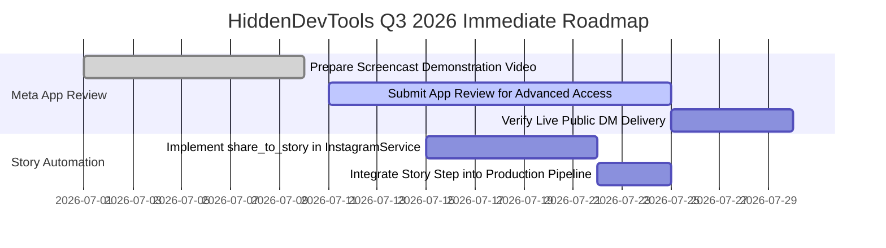

# Current Execution Roadmap (Q3 2026)

**Document ID:** HDT-EXEC-009  
**Category:** Project Overview  
**Version:** 1.0  
**Status:** Canonical Engineering Baseline  
**Cross-References:** [Timeline of Major Milestones](file:///e:/Vinitt/HiddenDevTools/HiddenDevTools-Engine/docs/00_Project_Overview/Timeline_of_Major_Milestones.md), [Future Roadmap](file:///e:/Vinitt/HiddenDevTools/HiddenDevTools-Engine/docs/00_Project_Overview/Future_Roadmap.md), [Current Completion Percentage](file:///e:/Vinitt/HiddenDevTools/HiddenDevTools-Engine/docs/00_Project_Overview/Current_Completion_Percentage.md)

---

## 1. Q3 2026 Immediate Execution Priorities

With the core engineering pipeline verified at **85.0% completion**, the immediate focus for the remainder of Q3 2026 is strictly dedicated to operational permission unblocking, live production graduation, and automated Instagram Story sharing.

---

## 2. Detailed Action Items & Technical Specifications

### Milestone M-06: Meta App Review & Live Advanced Access (Weeks 1-3)
* **Problem Statement:** In Standard Access (Development Mode), Meta Graph API blocks `POST /{page_id}/messages` when targeting Instagram users who are not explicitly registered as App Testers (`OAuthException Code 200 / Subcode 2534048`).
* **Execution Steps:**
  1. Record a high-definition screencast showing a test Instagram user commenting `DEV` on a published carousel, and the server responding immediately with a DM via the Graph API.
  2. Submit formal justification in the Meta Developer Dashboard under **App Review -> Requests** for permissions:
     * `instagram_manage_messages`: Required to send automated Direct Messages containing resource links to public commenters.
     * `instagram_manage_comments`: Required to read public comment payloads via webhooks.
     * `instagram_basic` & `instagram_content_publish`: Required for grid publishing.
  3. Upon receiving **Advanced Access**, remove temporary test accounts from the App Roles dashboard and verify live end-to-end DM delivery across public community comments.

### Milestone M-07: Automated Story Sharing & Archival (Weeks 3-4)
* **Problem Statement:** Currently, after `developer_tools_pipeline.py` successfully publishes the 9-slide carousel to the Instagram grid (`POST /{ig_user_id}/media_publish`), sharing that carousel to the brand's Instagram Story must be done manually via the mobile app.
* **Execution Steps:**
  1. Extend `InstagramService` ([services/instagram_service.py](file:///e:/Vinitt/HiddenDevTools/HiddenDevTools-Engine/services/instagram_service.py)) with a new method `share_to_story(media_id: str)` executing:
     * `POST /{ig_user_id}/media` with parameters: `media_type=STORIES`, `media_id={grid_carousel_media_id}`.
     * `POST /{ig_user_id}/media_publish` with `creation_id={story_container_id}`.
  2. Integrate `instagram.share_to_story(media_id)` directly into `developer_tools_pipeline.py` ([pipelines/developer_tools_pipeline.py:L220-L230](file:///e:/Vinitt/HiddenDevTools/HiddenDevTools-Engine/pipelines/developer_tools_pipeline.py#L220-L230)) immediately following grid publication verification.
  3. Emit structured log event `STORY_PUBLISHED` and record story status in Google Sheets metadata.
