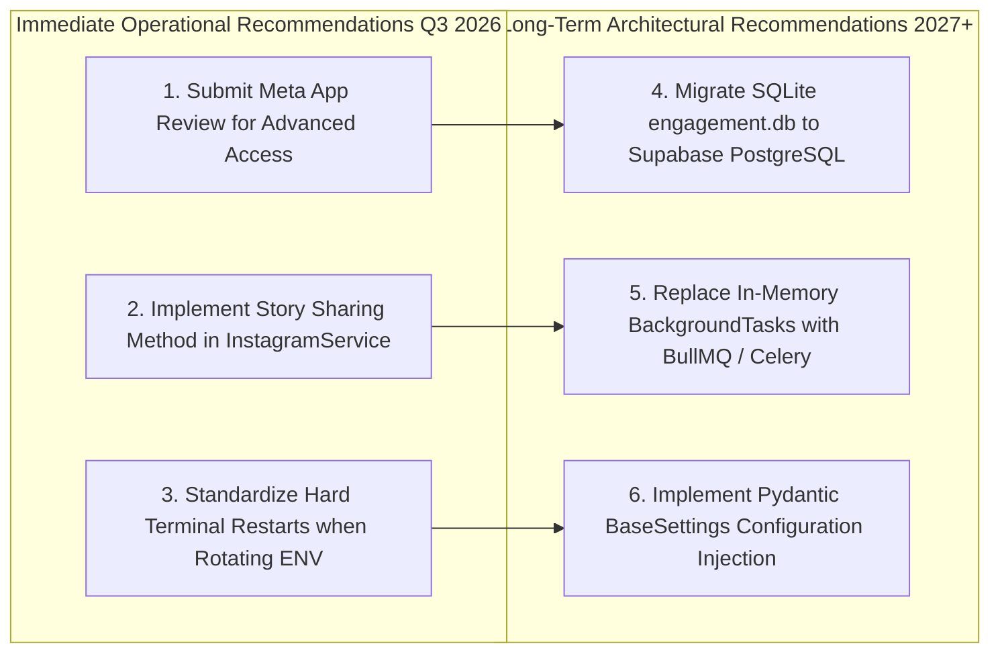

# Strategic Engineering & Operational Recommendations

**Document ID:** HDT-EXEC-014  
**Category:** Project Overview  
**Version:** 1.0  
**Status:** Canonical Engineering Baseline  
**Cross-References:** [Executive Summary](file:///e:/Vinitt/HiddenDevTools/HiddenDevTools-Engine/docs/00_Project_Overview/Executive_Summary.md), [Risks](file:///e:/Vinitt/HiddenDevTools/HiddenDevTools-Engine/docs/00_Project_Overview/Risks.md), [Current Roadmap](file:///e:/Vinitt/HiddenDevTools/HiddenDevTools-Engine/docs/00_Project_Overview/Current_Roadmap.md)

---

## 1. Executive Engineering Recommendations

Based on the exhaustive reverse-engineering audit of the `HiddenDevTools-Engine` repository (`e:\Vinitt\HiddenDevTools\HiddenDevTools-Engine`), the lead engineering architecture team recommends four immediate operational priorities and three long-term architectural upgrades.

---

## 2. Immediate Operational Recommendations (Next 30 Days)

### 1. Prioritize Meta App Review Submission (`instagram_manage_messages`)
* **Rationale:** The platform's highest-value user acquisition loop (`Comment -> Automated DM -> GitHub Repo Click`) is currently restricted by Meta's Standard Access rules (`Code 200 / Subcode 2534048`), which only allow messaging explicit App Testers.
* **Action:** Record a 2-minute end-to-end screen recording demonstrating the automated comment reply flow on a test account. Submit this screencast along with clear, compliance-aligned use-case descriptions in the Meta App Review dashboard immediately.

### 2. Add `share_to_story` to `InstagramService`
* **Rationale:** While `developer_tools_pipeline.py` automatically generates 9 slides and publishes them to the main Instagram grid, sharing the newly created carousel to the brand's Instagram Story is currently done manually.
* **Action:** Add `share_to_story(media_id: str)` to `services/instagram_service.py` (`POST /{ig_user_id}/media` with `media_type=STORIES`) and invoke it inside `developer_tools_pipeline.py` right after verifying the grid publish permalink.

### 3. Enforce Hard Process Restarts for `.env` Credential Updates
* **Rationale:** While `config.py` has been fixed with `load_dotenv(override=True)`, `uvicorn server:app --reload` worker processes can still inherit stale master environment states under certain Windows process spawning conditions.
* **Action:** Document in developer onboarding guides that modifying OAuth tokens or secrets in `.env` **requires shutting down (`Ctrl+C`) and restarting the python process cleanly (`python server.py`)**.

---

## 3. Long-Term Architectural Recommendations (Next 180 Days)

### 4. Migrate `engagement.db` to Supabase PostgreSQL
* **Rationale:** As community engagement grows, high-concurrency comment spikes on viral posts will increase write-lock contention (`SQLITE_BUSY`) inside `features/engagement/repository.py`.
* **Action:** Create a Supabase PostgreSQL migration (`003_pg_engagement.sql`) mirroring `processed_comments` schema, and replace `sqlite3.connect` calls with `SQLAlchemy` or `asyncpg` pools using row-level locking (`FOR UPDATE SKIP LOCKED`).

### 5. Replace `FastAPI.BackgroundTasks` with BullMQ / Redis
* **Rationale:** In-memory `background_tasks.add_task` queues inside `FastAPIDispatcher` drop unprocessed jobs if `server.py` undergoes an unexpected crash or container reboot during active DM dispatching.
* **Action:** Stand up a Redis container and replace `QueueDispatcher` with a persistent worker queue (**BullMQ** via Python or Celery) to guarantee persistence, dead-letter retry queues, and horizontal worker scaling across multiple independent compute nodes.

### 6. Replace Flat Constants with `Pydantic BaseSettings`
* **Rationale:** Flat module-level constants (`INSTAGRAM_ACCESS_TOKEN = os.getenv(...)` in `config.py`) impede dependency injection during unit testing and prevent dynamic runtime reloading of application settings.
* **Action:** Refactor `config.py` into a formal `pydantic-settings` `Settings(BaseSettings)` model, exposing typed, validated settings (`settings.instagram.access_token`) injected throughout services and routers.
