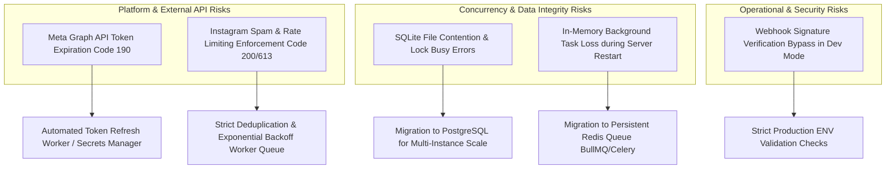

# High-Level Project Risk Assessment

**Document ID:** HDT-EXEC-013  
**Category:** Project Overview  
**Version:** 1.0  
**Status:** Canonical Engineering Baseline  
**Cross-References:** [Risk Register](file:///e:/Vinitt/HiddenDevTools/HiddenDevTools-Engine/docs/10_Security/Risk_Register.md), [Security Audit](file:///e:/Vinitt/HiddenDevTools/HiddenDevTools-Engine/docs/10_Security/Security.md), [Recommendations](file:///e:/Vinitt/HiddenDevTools/HiddenDevTools-Engine/docs/00_Project_Overview/Recommendations.md)

---

## 1. Executive Risk Summary

Operating an autonomous, multi-channel social publishing and automated direct messaging system exposes the engineering organization to specific platform dependency, operational, and security risks. The following risk evaluation highlights the top critical risks that require proactive monitoring and architectural mitigation.

---

## 2. Top Strategic Risks & Mitigation Strategies

### Risk 1: Long-Lived Meta Access Token Expiration (High Probability / High Impact)
* **Description:** Meta Business Access Tokens issued via Graph API Explorer or OAuth exchange typically expire after 60 days. When a token expires (`OAuthException Code 190 / Subcode 463`), all automated publishing (`publish_carousel`) and engagement responses (`send_message`) fail immediately.
* **Current Mitigation:** The system logs clear, structured errors specifying token expiration timestamps ([services/instagram_service.py:L140-L160](file:///e:/Vinitt/HiddenDevTools/HiddenDevTools-Engine/services/instagram_service.py#L140-L160)). `load_dotenv(override=True)` ensures fresh `.env` tokens are loaded upon process restart.
* **Long-Term Mitigation:** Implement an automated OAuth refresh cron worker that exchanges long-lived tokens (`GET /oauth/access_token?grant_type=fb_exchange_token`) every 45 days and stores the updated secret in a cloud secrets vault (AWS Secrets Manager / Infisical).

### Risk 2: Meta App Review & Automated Messaging Spam Restrictions (High Probability / Medium Impact)
* **Description:** Meta aggressively monitors automated Direct Messaging behavior on Instagram. If an app sends identical DMs at high velocity or to users who didn't trigger an interactive keyword (`DEV`), Meta can temporarily rate-limit or permanently suspend the app's `instagram_manage_messages` permission (`Code 200 / Subcode 2534048`).
* **Current Mitigation:** Double-deduplication enforcement in `CommentProcessor.process_event()` and `DeduplicationRepository` ensures that a user receives at most one DM per carousel post, regardless of how many comments they post.
* **Long-Term Mitigation:** Ensure varied, conversational message templates (`DM_TEMPLATE`) and maintain strict adherence to the 24-hour customer service messaging window.

### Risk 3: SQLite Database File Lock Contention (`SQLITE_BUSY`) (Medium Probability / Medium Impact)
* **Description:** SQLite uses file-level locking (`engagement.db`). If `DMWorker.process_queue()` executes a `claim_pending_comments` transaction (`BEGIN IMMEDIATE`) at the exact millisecond `CommentProcessor._save_comment_record()` writes a new incoming webhook event, SQLite may raise `sqlite3.OperationalError: database is locked`.
* **Current Mitigation:** `claim_pending_comments` acquires write locks immediately and executes in sub-millisecond durations (`LIMIT 10`). Under current single-server loads (~50 events/min), lock contention is negligible.
* **Long-Term Mitigation:** Migrate `processed_comments` table to Supabase PostgreSQL when scaling across multi-node or serverless worker environments.
