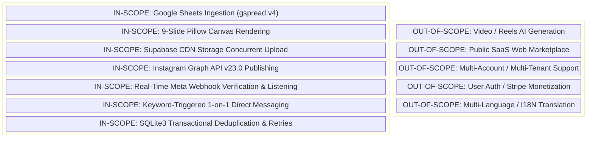

# Project Scope & System Boundaries

**Document ID:** HDT-EXEC-004  
**Category:** Project Overview  
**Version:** 1.0  
**Status:** Canonical Engineering Baseline  
**Cross-References:** [Project Vision](file:///e:/Vinitt/HiddenDevTools/HiddenDevTools-Engine/docs/00_Project_Overview/Project_Vision.md), [Product Goals](file:///e:/Vinitt/HiddenDevTools/HiddenDevTools-Engine/docs/00_Project_Overview/Product_Goals.md), [MVP Definition](file:///e:/Vinitt/HiddenDevTools/HiddenDevTools-Engine/docs/00_Project_Overview/MVP_Definition.md)

---

## 1. In-Scope Functional Boundaries (Current Platform Scope)

The current operational scope of the `HiddenDevTools-Engine` repository (`e:\Vinitt\HiddenDevTools\HiddenDevTools-Engine`) is strictly defined around the automated ingestion, visual rendering, cloud storage upload, social publishing, and interactive community engagement for Instagram Developer Tools carousels.

### Detailed In-Scope Modules:
1. **Spreadsheet Ingestion & Synchronization:**
   * Reading `Developer Tools` worksheet rows via Google Sheets Service Account credentials (`service_account.json`).
   * Transitioning status across the lifecycle: `Draft` -> `Rendering` -> `Rendered` -> `Uploading` -> `Uploaded` -> `Publishing` -> `Published` (or `Failed`).
   * Writing back generation metadata (`Generation ID`, `Generated At`), publishing metadata (`Instagram Media ID`, `Instagram Post URL`), and archive metadata (`Drive Folder ID`, `Drive Folder URL`).
2. **Visual Canvas Rendering Engine:**
   * Programmatic instantiation of `Pillow` image canvases using high-resolution base templates (`templates/developer_tools/*.png`).
   * Dynamic word-wrapping (`Engine.paragraph()`) with automatic font-size decrement (`size=23` down to `min_size=16`) to fit variable-length developer tool descriptions.
   * Multi-candidate TrueType font loading (`Inter_28pt-Bold.ttf`, `Inter_28pt-Regular.ttf`) with explicit RGB color tokens ([config.py:L129-L134](file:///e:/Vinitt/HiddenDevTools/HiddenDevTools-Engine/config.py#L129-L134)).
3. **Cloud Storage & Asset Verification:**
   * Uploading local slide folders (`output/DeveloperTools_TIMESTAMP/`) to Supabase Storage bucket (`posts`) under structured date paths (`YYYY/MM/DD/GenID`).
   * Performing multi-threaded uploads (`max_workers=3`) using `ThreadPoolExecutor` inside `SupabaseStorage` ([services/storage_service.py:L90-L160](file:///e:/Vinitt/HiddenDevTools/HiddenDevTools-Engine/services/storage_service.py#L90-L160)).
   * Programmatically validating every public CDN URL via HTTP `HEAD` (falling back to `GET`) before triggering Instagram publication.
4. **Instagram Business Account Publishing:**
   * Communicating with Meta Graph API `v23.0` (`https://graph.facebook.com/v23.0`) via `InstagramService` ([services/instagram_service.py](file:///e:/Vinitt/HiddenDevTools/HiddenDevTools-Engine/services/instagram_service.py)).
   * Creating individual media containers (`is_carousel_item=true`), polling processing status (`check_container_status`), assembling the `CAROUSEL` parent container, and triggering `media_publish`.
   * Verifying published objects exist on Meta servers via `GET /{media_id}` and extracting canonical permalinks (`https://www.instagram.com/p/ID/`).
5. **Real-Time Webhook Reception & Event Queuing:**
   * Exposing `GET /webhooks/meta` for Meta challenge verification (`hub.verify_token`) and `POST /webhooks/meta` for live comment events ([routers/meta_webhook.py](file:///e:/Vinitt/HiddenDevTools/HiddenDevTools-Engine/routers/meta_webhook.py)).
   * Validating `X-Hub-Signature-256` using HMAC-SHA256 (`META_APP_SECRET`).
   * Capturing raw payloads to disk (`fixtures/webhooks/YYYY/MM/`) for deterministic replay testing ([services/meta_webhook_service.py:L65-L83](file:///e:/Vinitt/HiddenDevTools/HiddenDevTools-Engine/services/meta_webhook_service.py#L65-L83)).
6. **Automated Keyword Matching & Direct Messaging:**
   * Normalizing comment text (`KeywordMatcher.normalize_text()`) and checking against `ENGAGEMENT_KEYWORDS` (`DEV`, `TOOLS`, `LINK`).
   * Enforcing double-deduplication: checking if the webhook event ID was already processed (`has_processed_comment`), and checking if the user already received a DM for that specific post (`has_user_received_dm`).
   * Dispatching DMs via `POST /{page_id}/messages` or `POST /me/messages` ([services/instagram_service.py:L205-L267](file:///e:/Vinitt/HiddenDevTools/HiddenDevTools-Engine/services/instagram_service.py#L205-L267)) with automatic retry state tracking (`attempt_count`, `next_retry_at`, exponential backoff).

---

## 2. Explicit Out-of-Scope Items (Non-Goals)

To prevent architectural degradation and uncontrolled scope creep, the following capabilities are **strictly out-of-scope** for the current engineering phase:
1. **❌ Video / Reel / Animation Generation:** The rendering engine `Engine` operates strictly on 2D static raster canvases (`Pillow RGBA`). Generating MP4/WebM video carousels, voiceovers, or AI avatars is out of scope.
2. **❌ Multi-Account / Multi-Tenant Support:** The system is explicitly designed for a single brand instance (`@hiddendevtools`). All configuration variables (`INSTAGRAM_BUSINESS_ACCOUNT_ID`, `FACEBOOK_PAGE_ID`, `SPREADSHEET_ID`) are singleton global constants.
3. **❌ Public Web Portal / User SaaS Dashboard:** There are no user-facing HTML frontend pages, authentication cookies, JWT login sessions, or billing/monetization gateways in this codebase.
4. **❌ Multi-Language Translation (I18N):** All font bounds, word wrapping rules, and DM templates (`DM_TEMPLATE` in `config.py`) assume UTF-8 English text.
5. **❌ Automated Post Deletion or Comment Scrubbing:** The bot does not delete Instagram posts, hide spam comments, or block users on Instagram.
