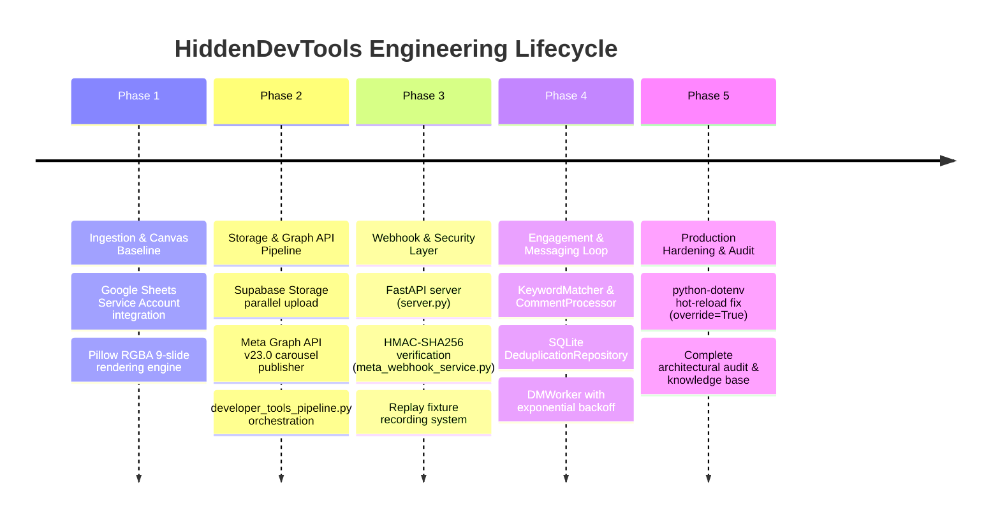

# Timeline of Major Engineering Milestones

**Document ID:** HDT-EXEC-008  
**Category:** Project Overview  
**Version:** 1.0  
**Status:** Canonical Engineering Baseline  
**Cross-References:** [Current Completion Percentage](file:///e:/Vinitt/HiddenDevTools/HiddenDevTools-Engine/docs/00_Project_Overview/Current_Completion_Percentage.md), [Current Roadmap](file:///e:/Vinitt/HiddenDevTools/HiddenDevTools-Engine/docs/00_Project_Overview/Current_Roadmap.md), [Future Roadmap](file:///e:/Vinitt/HiddenDevTools/HiddenDevTools-Engine/docs/00_Project_Overview/Future_Roadmap.md)

---

## 1. Historical & Current Engineering Milestones

The development of the `HiddenDevTools-Engine` repository has progressed through five distinct architectural phases, moving from basic script-driven image rendering to a fully autonomous, concurrency-immune publishing and real-time engagement platform.

---

## 2. Detailed Milestone Accomplishments

### Phase 1: Ingestion & Visual Rendering Engine (Milestone M-01)
* **Objective:** Establish programmatic discovery of draft content rows and render pixel-perfect 9-slide visual carousels without human design intervention.
* **Key Deliverables Completed:**
  * Created `SheetService` and `sheet_api.py` to communicate with Google Sheets using `gspread` v4 and service account authentication (`service_account.json`).
  * Built `Engine` ([engine.py](file:///e:/Vinitt/HiddenDevTools/HiddenDevTools-Engine/engine.py)) using `Pillow` to load custom TrueType fonts (`Inter_28pt-Bold.ttf`, `Inter_28pt-Regular.ttf`) and dynamically word-wrap text across canvas bounds down to `min_size=16`.
  * Created `DeveloperToolsRenderer` ([renderers/developer_tools_renderer.py](file:///e:/Vinitt/HiddenDevTools/HiddenDevTools-Engine/renderers/developer_tools_renderer.py)) to map exact X/Y design coordinates from `config.py` for 9 distinct carousel slides (`01_Cover.png` to `09_CTA.png`).

### Phase 2: Storage Ingestion & Graph API Publishing Pipeline (Milestone M-02)
* **Objective:** Automatically upload rendered slides to public CDN storage and publish them to the `@hiddendevtools` Instagram grid via Meta Graph API.
* **Key Deliverables Completed:**
  * Built `SupabaseStorage` ([services/storage_service.py](file:///e:/Vinitt/HiddenDevTools/HiddenDevTools-Engine/services/storage_service.py)) with `ThreadPoolExecutor(max_workers=3)` to concurrently upload all local slide assets and verify accessibility via HTTP `HEAD/GET`.
  * Built `InstagramService` ([services/instagram_service.py](file:///e:/Vinitt/HiddenDevTools/HiddenDevTools-Engine/services/instagram_service.py)) supporting the complete 3-step carousel lifecycle (`POST /{ig_user_id}/media` -> wait loop -> `POST /{ig_user_id}/media CAROUSEL` -> `POST /{ig_user_id}/media_publish`).
  * Assembled `developer_tools_pipeline.py` ([pipelines/developer_tools_pipeline.py](file:///e:/Vinitt/HiddenDevTools/HiddenDevTools-Engine/pipelines/developer_tools_pipeline.py)) incorporating scheduler file locking (`publishing.lock`), status transitions (`Rendering` -> `Published`), and best-effort archival to Google Drive (`DriveService`).

### Phase 3: Webhook Gateway & Cryptographic Verification (Milestone M-03)
* **Objective:** Create a secure, asynchronous HTTP server capable of receiving and authenticating real-time webhook notifications from Meta servers.
* **Key Deliverables Completed:**
  * Built `server.py` and `routers/meta_webhook.py` using FastAPI and `uvicorn`.
  * Implemented `GET /webhooks/meta` challenge verification (`hub.verify_token == META_VERIFY_TOKEN`).
  * Implemented `POST /webhooks/meta` cryptographic signature verification (`validate_signature`) verifying `X-Hub-Signature-256` using HMAC-SHA256 (`META_APP_SECRET`).
  * Added automated raw payload archiving to `fixtures/webhooks/YYYY/MM/` (`_save_for_replay`).

### Phase 4: Automated Engagement & Deduplicated Direct Messaging (Milestone M-04)
* **Objective:** Convert incoming Instagram comments into immediate, 1-on-1 direct messages containing repository links without double-messaging or race-condition collisions.
* **Key Deliverables Completed:**
  * Built `KeywordMatcher` and `CommentProcessor` to normalize incoming text and filter against `ENGAGEMENT_KEYWORDS` (`DEV`, `TOOLS`, `LINK`).
  * Created `DeduplicationRepository` ([features/engagement/repository.py](file:///e:/Vinitt/HiddenDevTools/HiddenDevTools-Engine/features/engagement/repository.py)) using SQLite `INSERT OR IGNORE` and explicit `BEGIN IMMEDIATE` transaction claim locking (`claim_pending_comments`).
  * Added `send_message` to `InstagramService` ([services/instagram_service.py:L205-L267](file:///e:/Vinitt/HiddenDevTools/HiddenDevTools-Engine/services/instagram_service.py#L205-L267)) sending `POST /{page_id}/messages` JSON payloads (`recipient={"id": "<IGSID>"}`, `message={"text": "..."}`).
  * Built `DMWorker` ([features/engagement/worker.py](file:///e:/Vinitt/HiddenDevTools/HiddenDevTools-Engine/features/engagement/worker.py)) with automated exponential backoff (`30s * 2^(attempt-1)` up to `MAX_DM_RETRIES=3`).

### Phase 5: Production Hardening, Architectural Audit & Knowledge Base (Milestone M-05 — Current)
* **Objective:** Eliminate operational gotchas, resolve uvicorn caching bugs, and establish an exhaustive, enterprise-grade engineering bible.
* **Key Deliverables Completed:**
  * Diagnosed and fixed `python-dotenv` environment variable retention bug during `uvicorn --reload` cycles by forcing `load_dotenv(override=True)` in `config.py`.
  * Generated 50+ canonical Markdown architectural specifications, ADRs, runbooks, schemas, and API documentation inside `docs/`.
