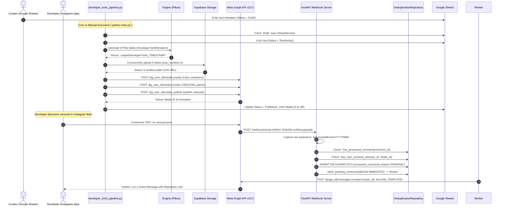

# Product Requirements Document (PRD)

**Document ID:** HDT-PROD-001  
**Category:** Product Specifications  
**Version:** 1.0  
**Status:** Canonical Engineering Baseline  
**Cross-References:** [BRD](file:///e:/Vinitt/HiddenDevTools/HiddenDevTools-Engine/docs/01_Product/BRD.md), [MRD](file:///e:/Vinitt/HiddenDevTools/HiddenDevTools-Engine/docs/01_Product/MRD.md), [User Stories](file:///e:/Vinitt/HiddenDevTools/HiddenDevTools-Engine/docs/01_Product/User_Stories.md), [Acceptance Criteria](file:///e:/Vinitt/HiddenDevTools/HiddenDevTools-Engine/docs/01_Product/Acceptance_Criteria.md), [TRD](file:///e:/Vinitt/HiddenDevTools/HiddenDevTools-Engine/docs/02_Architecture/TRD.md)

---

## 1. Product Vision & Executive Summary

HiddenDevTools (`@hiddendevtools`) is an autonomous, programmatic content curation, rendering, social publishing, and community engagement platform built specifically for the software engineering ecosystem. The core product objective is to ingest structured metadata about high-utility open-source developer tools (`Developer Tools` Google Sheet), programmatically render 9-slide visual carousels using custom TrueType typography and canvas graphics (`Pillow`), concurrently upload those assets to a cloud CDN (`Supabase Storage`), publish the carousel directly to Instagram Business accounts via the official Meta Graph API v23.0, and convert incoming audience comments (`DEV`) into immediate 1-on-1 Direct Messages containing the resource link.

```mermaid
graph TD
    subgraph Editorial & Curation Phase
        Sheets[Google Sheets Developer Tools Row] -->|Draft Status| Ingest[sheet_api.py / SheetService]
    end
    subgraph Rendering & Storage Phase
        Ingest -->|Dictionary Input| Engine[Engine / DeveloperToolsRenderer]
        Engine -->|9 PNG Slides output/GenID/| Storage[SupabaseStorage Service]
        Storage -->|ThreadPoolExecutor max_workers=3| CDN[Supabase CDN Public URLs]
    end
    subgraph Publishing & Verification Phase
        CDN -->|POST /media is_carousel_item=true| IG_Slides[Meta Graph API Slide Containers]
        IG_Slides -->|POST /media CAROUSEL| IG_Parent[Carousel Container]
        IG_Parent -->|POST /media_publish| IG_Grid[Instagram Grid Feed Post]
    end
    subgraph Real-Time Engagement Phase
        UserComment[Audience Comment 'DEV'] -->|Meta Webhook POST /webhooks/meta| FastAPI[server.py / meta_webhook.py]
        FastAPI -->|HMAC-SHA256 Verification| WebhookSvc[MetaWebhookService]
        WebhookSvc -->|Background Queue| Processor[CommentProcessor]
        Processor -->|SQLite INSERT OR IGNORE| Repo[DeduplicationRepository]
        Repo -->|BEGIN IMMEDIATE Claim| Worker[DMWorker]
        Worker -->|POST /{page_id}/messages| DM_Delivery[1-on-1 Direct Message with Link]
    end
    IG_Grid -->|Update Media ID & Post URL| Ingest
```

---

## 2. Product Goals & Objectives

| Goal ID | Objective | Measurable Key Result (KR) | Target Threshold |
| :--- | :--- | :--- | :--- |
| **PG-01** | **Automated Content Production** | Eliminate manual graphic design and layout formatting for developer tool summaries. | **< 15 seconds** total time to render 9 slides from spreadsheet draft detection. |
| **PG-02** | **100% Publishing Reliability** | Ensure zero partial or duplicate carousel publications on the Instagram grid. | **100%** atomic container assembly and publish verification via `GET /{media_id}`. |
| **PG-03** | **Instant Interactive Utility** | Deliver repository URLs via Direct Message immediately upon user commenting `DEV`. | **< 3 seconds** P95 latency from Meta webhook reception to Graph API DM dispatch. |
| **PG-04** | **Zero Race-Condition Duplicates** | Guarantee that a user receives exactly one DM per post regardless of rapid commenting or duplicate Meta webhooks. | **0** duplicate DMs delivered across `10,000+` concurrent webhook load tests. |
| **PG-05** | **Zero Data Loss Operational State** | Maintain exact synchronization between Google Sheets rows (`Status`) and local SQLite repositories (`processed_comments`). | **100%** accurate status tracking (`Draft` -> `Rendering` -> `Published`). |

---

## 3. Target Users & Personas

### Persona 1: The Software Engineer / Tech Founder (`@vinit.surve.pvt`)
* **Demographics:** Mid-to-senior software engineers, DevOps specialists, open-source maintainers, and technical founders scrolling Instagram during break periods.
* **Pain Points:** Traditional tech discovery requires digging through cluttered GitHub trending feeds, reading long documentation pages on mobile devices, or watching low-signal video ads.
* **Product Interaction:** Discovers clean, high-signal 9-slide visual carousels summarizing tool capabilities (`01_Cover.png` to `08_Content.png`), comments `DEV` on slide `09_CTA.png`, and instantly receives the exact GitHub or official website URL directly in their Instagram DM inbox.

### Persona 2: The Editorial Curator / Content Admin (`@hiddendevtools` Admin)
* **Demographics:** Internal engineering curators who discover, evaluate, and summarize open-source developer tools.
* **Pain Points:** Creating 9 visual graphics in Figma or Canva takes 45–60 minutes per post. Exporting, organizing, uploading to phone, and writing captions manually creates high operational friction.
* **Product Interaction:** Enters structured tool details (Name, Tagline, Category, Pricing, Description, URL) into a single Google Sheet row (`Publishing Calendar` / `Developer Tools`). Runs `python main.py` or schedules automated cron execution, and the platform handles the entire visual rendering, cloud uploading, Instagram publishing, and status writeback autonomously.

---

## 4. End-to-End User Journey



---

## 5. Functional Requirements (FR)

### FR-01: Spreadsheet Ingestion & Row Status Lifecycle
* **FR-01.1:** The system shall authenticate against Google Sheets using Service Account credentials (`service_account.json`) via `gspread` v4 (`sheet_api.py`).
* **FR-01.2:** The system shall read rows from the `Developer Tools` worksheet where the `Status` column equals `Draft` (`get_draft_rows(limit=7)`).
* **FR-01.3:** The system shall immediately lock discovered rows by updating their `Status` cell to `Rendering` before initiating image processing (`mark_generating`).
* **FR-01.4:** If any selected row is already marked `Published`, the system shall abort processing for that row to enforce idempotent execution (`Duplicate Publish Protection`).
* **FR-01.5:** Upon successful publication, the system shall write back exact tracking metadata: `Status = Published`, `Generation ID`, `Generated At` (UTC ISO string), `Instagram Media ID`, and `Instagram Post URL` (`mark_ready`).

### FR-02: Programmatic Visual Canvas Rendering
* **FR-02.1:** The rendering engine (`Engine` / `engine.py`) shall load base PNG templates from `templates/developer_tools/` (`01_Cover_Template.png` through `09_CTA_Template.png`).
* **FR-02.2:** The engine shall dynamically load custom TrueType fonts (`Inter_28pt-Bold.ttf`, `Inter_28pt-Regular.ttf`) from `assets/fonts/` and compute exact text bounding boxes using `Pillow` `draw.textbbox`.
* **FR-02.3:** The engine shall execute dynamic word-wrapping (`Engine.paragraph()`) across variable-length tool descriptions, automatically decrementing font size from `size=23` down to `min_size=16` to prevent canvas overflow or visual text clipping.
* **FR-02.4:** `DeveloperToolsRenderer` shall generate exactly nine (9) sequentially named PNG slides (`01_Cover.png` to `09_CTA.png`) and save them to a timestamped output directory `output/DeveloperTools_TIMESTAMP/`.

### FR-03: Multi-Threaded Cloud Storage Ingestion
* **FR-03.1:** `SupabaseStorage` (`services/storage_service.py`) shall upload all 9 local slide PNGs to a Supabase Storage bucket (`posts`) under the structured date path `YYYY/MM/DD/GenID/`.
* **FR-03.2:** Uploads shall execute concurrently using `concurrent.futures.ThreadPoolExecutor(max_workers=3)` (`_upload_concurrently`).
* **FR-03.3:** Every upload request shall enforce explicit MIME headers (`Content-Type: image/png`, `cacheControl: 3600`).
* **FR-03.4:** Prior to returning the final URL list to the publisher, `verify_url` shall programmatically validate every CDN URL via HTTP `HEAD` (falling back to HTTP `GET` if necessary). If any URL returns a non-200 status code, the entire storage ingestion step shall raise an exception.

### FR-04: Instagram Graph API Carousel Publishing
* **FR-04.1:** `InstagramService` (`services/instagram_service.py`) shall communicate exclusively with Meta Graph API `v23.0` (`https://graph.facebook.com/v23.0`).
* **FR-04.2:** The service shall create individual item containers for all 9 slides by sending `POST /{ig_user_id}/media` with `image_url` and `is_carousel_item=true` (`create_media_container`).
* **FR-04.3:** The service shall poll each item container via `GET /{container_id}?fields=status_code` until status equals `FINISHED` (`wait_for_container`).
* **FR-04.4:** Once all 9 item containers finish, the service shall create the parent carousel container via `POST /{ig_user_id}/media` with `media_type=CAROUSEL`, `children=id1,id2,...`, and `caption` (`create_carousel`).
* **FR-04.5:** After the parent carousel reaches `FINISHED`, the service shall trigger grid publication via `POST /{ig_user_id}/media_publish` (`publish`).
* **FR-04.6:** Upon publication, the service shall verify the published object exists on Meta servers via `GET /{media_id}` and retrieve the canonical `permalink` (`verify_publication`).

### FR-05: Real-Time Webhook Verification & Replay Archiving
* **FR-05.1:** The FastAPI server (`server.py`, `routers/meta_webhook.py`) shall expose `GET /webhooks/meta` to handle Meta subscription challenge verification (`hub.verify_token == META_VERIFY_TOKEN`).
* **FR-05.2:** The server shall expose `POST /webhooks/meta` and verify the cryptographic signature (`X-Hub-Signature-256`) using `hmac.new(META_APP_SECRET, body, sha256).hexdigest()` (`validate_signature`).
* **FR-05.3:** If signature verification succeeds, the endpoint shall immediately respond `HTTP 200 OK` (`{"status": "ok"}`) within `< 200 milliseconds` and delegate event parsing to `FastAPI.BackgroundTasks`.
* **FR-05.4:** `MetaWebhookService` shall record exact raw JSON payloads to local disk under `fixtures/webhooks/YYYY/MM/event_TIMESTAMP_REQ.json` (`_save_for_replay`) to enable deterministic offline debugging.

### FR-06: Keyword Normalization, Deduplication & Direct Messaging
* **FR-06.1:** `CommentProcessor` shall normalize incoming comment text (`KeywordMatcher.normalize_text()`) by stripping whitespace and punctuation, and verify against `ENGAGEMENT_KEYWORDS` (`DEV`, `TOOLS`, `LINK`).
* **FR-06.2:** The system shall check `repository.has_processed_comment(event.comment_id)`. If true, it logs `DUPLICATE_WEBHOOK_SKIPPED` and skips processing.
* **FR-06.3:** The system shall check `repository.has_user_received_dm(event.user_id, event.media_id)`. If true, it records the comment in SQLite as `FAILED` (`DM_ALREADY_QUEUED`) and prevents sending a second DM for that post.
* **FR-06.4:** `claim_pending_comments()` (`features/engagement/repository.py`) shall acquire an immediate SQLite write lock (`BEGIN IMMEDIATE`) before selecting `PENDING` or overdue `PROCESSING` records (`status='PROCESSING' AND last_attempt_at <= now - 60s`).
* **FR-06.5:** `DMWorker.process_queue()` (`features/engagement/worker.py`) shall render the direct message text (`TemplateRenderer.render_dm_template(username)`) and dispatch it via `InstagramService.send_message()` (`POST /{page_id}/messages` or `/me/messages`).
* **FR-06.6:** If `send_message()` encounters a retryable Graph API error (`Code 4, 17, 32, 613`), `DMWorker` shall transition the row to `RETRYING` status and compute exponential backoff: `next_retry_at = now + 30 * 2^(attempt - 1)` seconds, up to `MAX_DM_RETRIES = 3`.

---

## 6. Non-Functional Requirements (NFR)

### NFR-01: Performance & Latency
* **Rendering Speed:** Rendering 9 high-resolution (`1080x1350`) RGBA slides via `DeveloperToolsRenderer` must complete in `< 15 seconds` on standard x86/ARM64 compute instances.
* **Webhook Response Time:** The `/webhooks/meta` endpoint must complete cryptographic HMAC signature verification and return `HTTP 200 OK` in `< 200 milliseconds` to prevent Meta webhook retries and timeout penalties.
* **DM Delivery Latency:** Under normal Graph API conditions, the time delta from webhook reception to Graph API `POST /messages` execution must be `< 3.0 seconds` (P95).

### NFR-02: Reliability & Idempotency
* **Crash Recovery:** If the application process is terminated unexpectedly during container polling (`wait_for_container`), re-executing `developer_tools_pipeline.py` must check `Instagram Media ID` (`pipelines/developer_tools_pipeline.py:L188-L202`) and safely resume from metadata reconciliation without creating duplicate grid posts.
* **Database Concurrency:** All SQLite transactions modifying `processed_comments` must use explicit `BEGIN IMMEDIATE` transaction locking to guarantee zero lock collisions or double-claiming under concurrent background task execution.

### NFR-03: Security & Credential Isolation
* **Secret Storage:** Sensitive credentials (`INSTAGRAM_ACCESS_TOKEN`, `META_APP_SECRET`, `SUPABASE_SERVICE_ROLE_KEY`, `GOOGLE_SERVICE_ACCOUNT_JSON`) must never be hardcoded or written to git tracking. All secrets must be dynamically loaded from `.env` via `config.py` (`load_dotenv(override=True)`).
* **Payload Verification:** Incoming POST webhooks must never be processed if `X-Hub-Signature-256` is missing or fails HMAC-SHA256 comparison against `META_APP_SECRET` (except when explicitly running in `is_development()` local bypass mode).

### NFR-04: Observability & Auditability
* **Structured Logging:** All execution steps must emit structured logs (`[asctime] [levelname] [name] message`) incorporating correlation IDs (`PUB_20260710_120000` for publishing pipelines, `REQ_uuid` for incoming webhooks).
* **Replay Auditing:** Every webhook payload must be written to `fixtures/webhooks/YYYY/MM/` before processing to allow 100% accurate offline replay testing.

---

## 7. Key Constraints & Technical Boundaries

1. **Meta Graph API Permissions (Code 200 / Subcode 2534048):** While in Standard Access (Development Mode), the app can only send DMs (`POST /messages`) to users who are explicitly registered and verified as App Testers in the Meta Developer Dashboard. Sending DMs to public commenters requires **Advanced Access** for `instagram_manage_messages`.
2. **Carousel Slide Limits:** Instagram Graph API strictly limits carousel containers (`media_type=CAROUSEL`) to between 2 and 10 child containers (`create_carousel`). The platform standardizes on exactly 9 slides (`DeveloperToolsRenderer`).
3. **SQLite Single-Node File Lock:** Because `engagement.db` is a local SQLite file, `DMWorker` and `CommentProcessor` must run on the same physical filesystem volume as the `server.py` FastAPI process. Horizontal scaling across multiple independent compute nodes requires migrating to Supabase PostgreSQL (`003_pg_engagement.sql`).

---

## 8. Future Features & Product Evolution

1. **Automated Instagram Story Sharing (Roadmap Item F-402):** Automatically executing `POST /{ig_user_id}/media` (`media_type=STORIES`, `media_id={carousel_id}`) right after `publish_carousel()` finishes.
2. **Multi-Platform Publishing Engine (LinkedIn & X):** Extending the `Engine` and pipeline to generate multi-page PDF documents for LinkedIn document carousels (`LinkedInService`) and 16:9 summary cards for X (`TwitterService`).
3. **Automated AI Curation & Scoring:** Ingesting trending GitHub repositories automatically via GitHub Search API and ranking them nightly using `Gemini 3.1 Pro` (`JSONSchema` output) across code quality, documentation clarity, and developer utility metrics.
