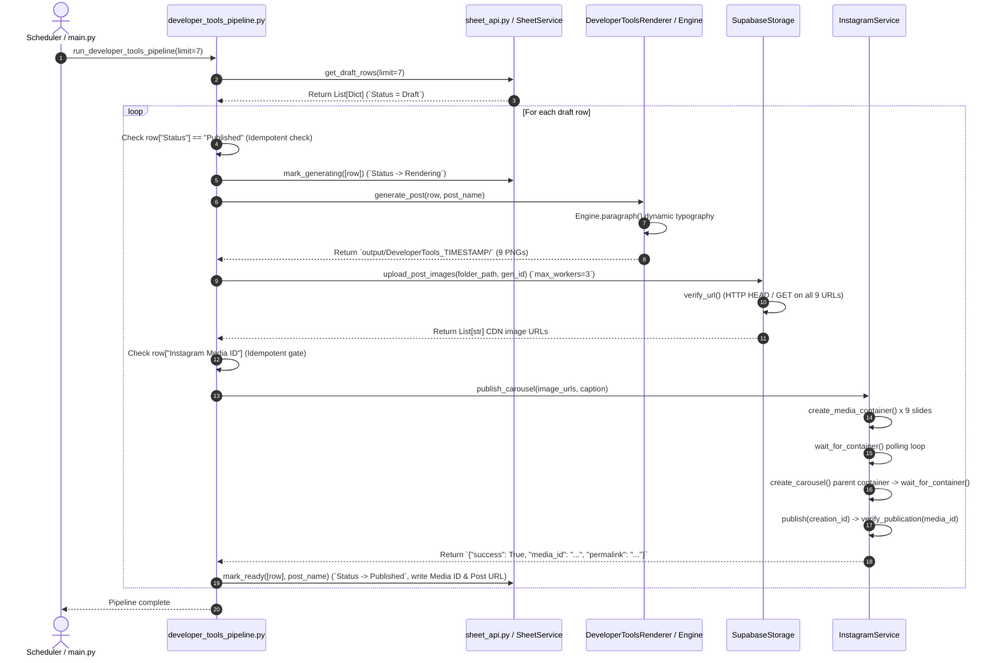
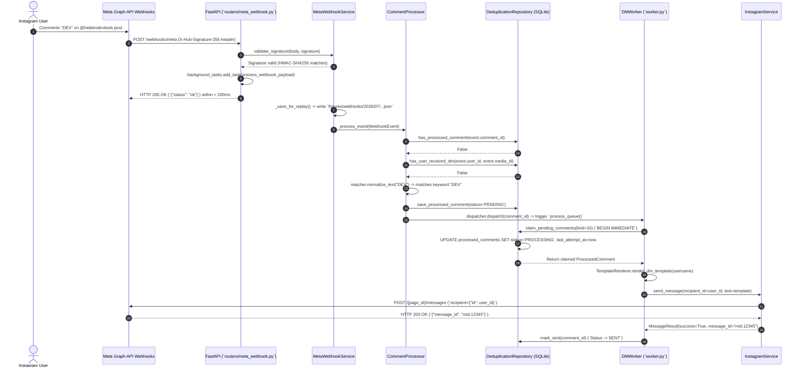
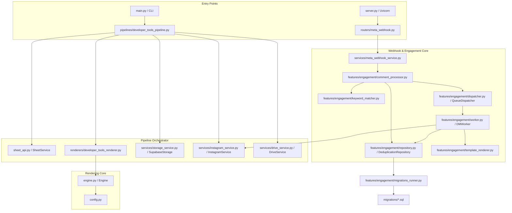

# System Architecture Specifications

**Document ID:** HDT-ARCH-002  
**Category:** Architectural Specifications  
**Version:** 1.0  
**Status:** Canonical Engineering Baseline  
**Cross-References:** [TRD](file:///e:/Vinitt/HiddenDevTools/HiddenDevTools-Engine/docs/02_Architecture/TRD.md), [Backend](file:///e:/Vinitt/HiddenDevTools/HiddenDevTools-Engine/docs/03_Backend/Backend.md), [Complete System Architecture](file:///e:/Vinitt/HiddenDevTools/HiddenDevTools-Engine/docs/diagrams/Complete_System_Architecture.md)

---

## 1. High-Level Layered Architecture & Service Boundaries

HiddenDevTools is architected as a clean layered monolith with strict domain separation across four distinct layers: Ingestion & Orchestration Layer, Rendering Layer, Cloud Integration Layer, and Real-Time Event & Engagement Layer.

```mermaid
graph TB
    subgraph Layer 1: Ingestion & Orchestration
        Main[main.py / Scheduler Cron] -->|Trigger| Pipeline[pipelines/developer_tools_pipeline.py]
        Pipeline -->|Fetch Draft Rows| SheetAPI[sheet_api.py / SheetService]
    end
    subgraph Layer 2: Visual Canvas Rendering
        Pipeline -->|Dictionary Input| Renderer[renderers/developer_tools_renderer.py]
        Renderer -->|Pillow Canvas Draw| Engine[engine.py / Engine]
        Engine -->|Write Local Assets| OutputDir[output/DeveloperTools_TIMESTAMP/]
    end
    subgraph Layer 3: Cloud Integrations & Publishing
        OutputDir -->|Concurrent Upload| StorageSvc[services/storage_service.py / SupabaseStorage]
        StorageSvc -->|Return CDN URLs| Pipeline
        Pipeline -->|3-Stage Graph API Publish| IGSvc[services/instagram_service.py / InstagramService]
        Pipeline -->|Archive Assets| DriveSvc[services/drive_service.py / DriveService]
        IGSvc -->|Status Writeback| SheetAPI
    end
    subgraph Layer 4: Real-Time Event & Engagement Layer
        Webhook[Meta Webhooks POST /webhooks/meta] -->|HMAC Verify| Router[routers/meta_webhook.py]
        Router -->|Background Dispatch| WebhookSvc[services/meta_webhook_service.py]
        WebhookSvc -->|Replay Save & Parse| CommentProc[features/engagement/comment_processor.py]
        CommentProc -->|Keyword Normalization| KeywordMatch[features/engagement/keyword_matcher.py]
        CommentProc -->|BEGIN IMMEDIATE Claim| Repo[features/engagement/repository.py / SQLite]
        Repo -->|Idempotent Claim| Worker[features/engagement/worker.py / DMWorker]
        Worker -->|POST /{page_id}/messages| IGSvc
    end
```

---

## 2. Complete Execution & Request Lifecycle Sequences

### 2.1 Publishing Pipeline Execution Flow (`developer_tools_pipeline.py`)



---

### 2.2 Webhook Reception & Direct Messaging Pipeline Sequence (`Comment -> DM`)



---

## 3. Folder Philosophy & Code Organization

The repository enforces strict domain separation, isolating configuration, database migrations, rendering assets, domain features, orchestration pipelines, HTTP server endpoints, and external adapters into clean folder hierarchies:

```
HiddenDevTools-Engine/
├── assets/                     # TrueType fonts (Inter_28pt-*.ttf) and static icons
├── templates/developer_tools/  # 1080x1350 PNG slide base templates (Cover to CTA)
├── migrations/                 # SQLite database migration SQL scripts (001_initial.sql, 002...)
├── config.py                   # Singleton global settings with load_dotenv(override=True)
├── engine.py                   # Core Pillow canvas rendering class (`Engine`)
├── generator.py                # Legacy single-post generation adapter
├── main.py                     # CLI entry point for scheduled carousel generation
├── server.py                   # Uvicorn FastAPI application factory (`create_app`)
├── sheet_api.py                # Google Sheets functional abstraction layer
├── schedule.py                 # Weekly publishing schedule inspector
├── utils.py                    # Filesystem output directory naming utilities
│
├── renderers/                  # Domain-specific visual layout renderers
│   ├── base_renderer.py        # Abstract base class for all renderers
│   └── developer_tools_renderer.py # 9-slide Developer Tools carousel renderer
│
├── pipelines/                  # End-to-end orchestration workflows
│   └── developer_tools_pipeline.py # Main production publishing orchestration pipeline
│
├── routers/                    # FastAPI HTTP controllers
│   ├── health.py               # GET /health check endpoint
│   └── meta_webhook.py         # GET/POST /webhooks/meta Meta challenge and event endpoint
│
├── services/                   # External API & storage service adapters
│   ├── caption_service.py      # Caption resolution precedence engine
│   ├── drive_service.py        # Google Drive folder archival adapter
│   ├── generation_service.py   # Multi-thread/async slide rendering service wrapper
│   ├── instagram_service.py    # Meta Graph API v23.0 publishing and messaging client
│   ├── meta_webhook_service.py # Cryptographic signature validation and replay saver
│   ├── sheet_service.py        # Google Sheets row locking and status synchronization
│   └── storage_service.py      # Supabase Storage multi-threaded parallel upload client
│
├── models/                     # Shared domain primitives and DTOs
│   └── webhook_event.py        # WebhookEvent data class
│
├── features/                   # Isolated business feature modules
│   └── engagement/             # Instagram comment-to-DM engagement loop
│       ├── comment_processor.py # Comment processing, deduplication, and status routing
│       ├── dispatcher.py       # In-memory FastAPI.BackgroundTasks queue dispatcher
│       ├── keyword_matcher.py  # Text normalization and keyword matching engine
│       ├── migrations_runner.py# Automatic SQLite schema migration executor
│       ├── models.py           # ProcessedComment and DMStatus domain models
│       ├── repository.py       # SQLite transactional deduplication repository (`BEGIN IMMEDIATE`)
│       ├── template_renderer.py # Dynamic DM message template formatter
│       └── worker.py           # Idempotent DM dispatch worker with exponential backoff
│
├── tests/                      # Automated unit and integration test suite
│   └── test_engagement.py      # Comprehensive tests for engagement loop and race conditions
└── docs/                       # Exhaustive engineering knowledge base (this hierarchy)
```

---

## 4. Component Dependency Graph & Call Graph


