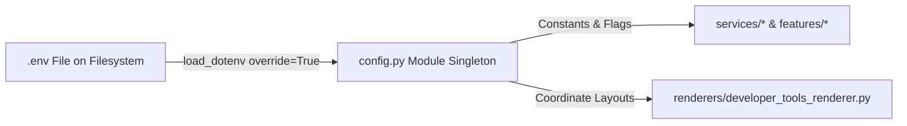

# Complete System Configuration & Environment Reference (`Configuration.md`)

**Document ID:** HDT-BACK-002  
**Category:** Backend Specifications  
**Version:** 1.0  
**Status:** Canonical Engineering Baseline  
**Cross-References:** [Backend](file:///e:/Vinitt/HiddenDevTools/HiddenDevTools-Engine/docs/03_Backend/Backend.md), [Security Audit](file:///e:/Vinitt/HiddenDevTools/HiddenDevTools-Engine/docs/10_Security/Security.md), [TRD](file:///e:/Vinitt/HiddenDevTools/HiddenDevTools-Engine/docs/02_Architecture/TRD.md)

---

## 1. Environment Loading Mechanics & `load_dotenv(override=True)`

The `HiddenDevTools-Engine` configuration engine (`config.py`) manages all application constants, API secrets, storage endpoints, database paths, and visual design layout coordinates.



### Critical Operational Rule:
`config.py` ([config.py:L1-L2](file:///e:/Vinitt/HiddenDevTools/HiddenDevTools-Engine/config.py#L1-L2)) explicitly invokes:
```python
from dotenv import load_dotenv
load_dotenv(override=True)
```
* **Why `override=True`?** By default (`override=False`), Python `load_dotenv()` will not overwrite an environment variable that is already present inside `os.environ`. When running `uvicorn server:app --reload` during local development, parent terminal processes retain master environment dictionaries across child process reloads. If a developer edits an expired OAuth token in `.env`, `override=False` causes the child reloader to ignore the updated `.env` file and continue failing with Graph API `Code 190 (Session expired)`. Setting `override=True` forces fresh `.env` parsing upon every module import.

---

## 2. Exhaustive Environment Variables & Constants Dictionary

The following table documents every global constant and environment variable defined in `config.py`, its data type, default fallback, target subsystem, and security classification.

| Constant Name (`config.py`) | `.env` Variable Name | Data Type | Default / Fallback Value | Subsystem Consuming | Security / Secret Status | Description & Operational Purpose |
| :--- | :--- | :--- | :--- | :--- | :--- | :--- |
| `ENV` | `ENV` | `str` | `"production"` | `config.is_development()`, Webhook Server | **Public / Non-Secret** | Controls environment execution mode. If set to `"development"`, `is_development()` returns `True`, disabling strict HMAC signature verification for local testing. |
| `PORT` | `PORT` | `int` | `8000` | `server.py` | **Public / Non-Secret** | TCP port where `uvicorn` binds the FastAPI HTTP server. |
| `META_VERIFY_TOKEN` | `META_VERIFY_TOKEN` | `str` | `"hidden_dev_tools_secret_verify"` | `routers/meta_webhook.py` | **Secret** | Arbitrary verification string submitted in Meta App Dashboard during initial `GET /webhooks/meta` webhook subscription verification. |
| `META_APP_SECRET` | `META_APP_SECRET` | `str` | `"YOUR_META_APP_SECRET"` | `services/meta_webhook_service.py` | **CRITICAL SECRET** | The exact Meta App Secret string obtained from App Dashboard. Used by `hmac.new(sha256)` to verify `X-Hub-Signature-256` headers. |
| `INSTAGRAM_ACCESS_TOKEN` | `INSTAGRAM_ACCESS_TOKEN` | `str` | `""` | `services/instagram_service.py` | **CRITICAL SECRET** | Long-lived Facebook Page / Instagram Business OAuth access token with `instagram_basic`, `instagram_content_publish`, `instagram_manage_comments`, and `instagram_manage_messages` permissions. |
| `INSTAGRAM_BUSINESS_ACCOUNT_ID` | `INSTAGRAM_BUSINESS_ACCOUNT_ID` | `str` | `""` | `services/instagram_service.py` | **Public ID** | Canonical Instagram Business Account ID (`IGSID`). Used as the root path for all `/{ig_user_id}/media` container requests. |
| `FACEBOOK_PAGE_ID` | `FACEBOOK_PAGE_ID` | `str` | `""` | `services/instagram_service.py` | **Public ID** | Connected Facebook Page ID. Used for `POST /{page_id}/messages` when sending Direct Messages via Graph API. |
| `GRAPH_API_VERSION` | `GRAPH_API_VERSION` | `str` | `"v23.0"` | `services/instagram_service.py` | **Public / Non-Secret** | Target Meta Graph API endpoint version string (`https://graph.facebook.com/v23.0`). |
| `SUPABASE_URL` | `SUPABASE_URL` | `str` | `""` | `services/storage_service.py` | **Public Endpoint** | Root Supabase project HTTPS endpoint (`https://xxxx.supabase.co`). |
| `SUPABASE_SERVICE_ROLE_KEY` | `SUPABASE_SERVICE_ROLE_KEY` | `str` | `""` | `services/storage_service.py` | **CRITICAL SECRET** | Supabase Service Role (Admin) JWT token allowing unrestricted write access to storage buckets (`Authorization: Bearer <KEY>`). |
| `STORAGE_BUCKET_POSTS` | `STORAGE_BUCKET_POSTS` | `str` | `"posts"` | `services/storage_service.py` | **Public / Non-Secret** | Target Supabase Storage bucket name where rendered PNG slides (`output/GenID/*.png`) are uploaded. |
| `GOOGLE_SERVICE_ACCOUNT_JSON` | `GOOGLE_SERVICE_ACCOUNT_JSON` | `str` | `"service_account.json"` | `sheet_api.py`, `services/drive_service.py` | **CRITICAL SECRET PATH** | Absolute or relative filesystem path to the Google Service Account JSON credentials file. |
| `SPREADSHEET_ID` | `SPREADSHEET_ID` | `str` | `"1wXl...QyS8"` | `sheet_api.py` | **Public ID** | Google Sheets document ID for the editorial curation calendar. |
| `STATUS_COLUMN` | N/A (Code Constant) | `str` | `"Status"` | `sheet_api.py`, `developer_tools_pipeline.py` | **Public / Non-Secret** | Google Sheets column header string inspected for status transitions (`Draft` -> `Rendering` -> `Published`). |
| `DRIVE_FOLDER_ID` | `DRIVE_FOLDER_ID` | `str` | `"1t40...623j"` | `services/drive_service.py` | **Public ID** | Parent Google Drive folder ID where post backup folders are created. |
| `SQLITE_DB_PATH` | `SQLITE_DB_PATH` | `str` | `"engagement.db"` | `features/engagement/repository.py` | **Filesystem Path** | Relative path to local SQLite database file storing deduplication records (`processed_comments`). |
| `PROCESSING_TIMEOUT_SECONDS` | `PROCESSING_TIMEOUT_SECONDS` | `int` | `60` | `features/engagement/repository.py` | **Public / Non-Secret** | Number of seconds before a comment stuck in `PROCESSING` status is considered timed-out and reclaimable by `claim_pending_comments`. |
| `WORKER_BATCH_SIZE` | `WORKER_BATCH_SIZE` | `int` | `10` | `features/engagement/worker.py` | **Public / Non-Secret** | Maximum number of rows claimed by `DMWorker.process_queue()` per sweep (`LIMIT 10`). |
| `MAX_DM_RETRIES` | `MAX_DM_RETRIES` | `int` | `3` | `features/engagement/worker.py` | **Public / Non-Secret** | Maximum number of exponential backoff retry attempts (`30s * 2^attempt`) allowed per failed DM. |
| `ENGAGEMENT_MODE` | `ENGAGEMENT_MODE` | `EngagementMode(Enum)` | `EngagementMode.KEYWORD` | `features/engagement/comment_processor.py` | **Public / Non-Secret** | Controls engagement rule: `EngagementMode.KEYWORD` requires matching tokens (`DEV`), while `EngagementMode.ANY_COMMENT` queues DMs for all comments. |
| `ENGAGEMENT_KEYWORDS` | `ENGAGEMENT_KEYWORDS` | `List[str]` | `["DEV", "TOOLS", "LINK"]` | `features/engagement/keyword_matcher.py` | **Public / Non-Secret** | Target keyword strings checked during `match_keyword(normalized_text)`. |
| `DM_TEMPLATE` | `DM_TEMPLATE` | `str` | `"Hey @{username}! Here is the direct link..."` | `features/engagement/template_renderer.py` | **Public / Non-Secret** | Python format string used to generate 1-on-1 Direct Message responses. |
| `DEFAULT_CAPTION_TEMPLATE` | `DEFAULT_CAPTION_TEMPLATE` | `str` | `"🚀 Discover top Developer Tools..."` | `services/caption_service.py` | **Public / Non-Secret** | Fallback caption string used when `Caption` column is blank on both the draft row and today's schedule. |

---

## 3. Visual Layout Coordinate Systems (`config.py`)

To ensure deterministic canvas rendering across `DeveloperToolsRenderer` ([renderers/developer_tools_renderer.py](file:///e:/Vinitt/HiddenDevTools/HiddenDevTools-Engine/renderers/developer_tools_renderer.py)), `config.py` exports strict `(X, Y)` and `(Width, Height)` coordinate dictionaries for every slide element (`1080x1350` canvas):

```python
# Slide 01: Cover Page Coordinates
SLIDE_1_COORDS = {
    "title": {"x": 100, "y": 420, "max_width": 880, "max_height": 280, "font_size": 72},
    "tagline": {"x": 100, "y": 740, "max_width": 880, "max_height": 200, "font_size": 36},
    "category_badge": {"x": 100, "y": 300, "font_size": 28}
}

# Slide 02..08: Content Page Coordinates
SLIDE_CONTENT_COORDS = {
    "title": {"x": 100, "y": 180, "max_width": 880, "max_height": 140, "font_size": 48},
    "description": {"x": 100, "y": 360, "max_width": 880, "max_height": 620, "font_size": 32},
    "pricing": {"x": 100, "y": 1040, "font_size": 28}
}

# Color Tokens (RGB tuples)
COLOR_TEXT_PRIMARY = (255, 255, 255)       # White
COLOR_TEXT_MUTED = (148, 163, 184)         # Slate-400
COLOR_ACCENT_BLUE = (37, 99, 235)          # Blue-600
```
