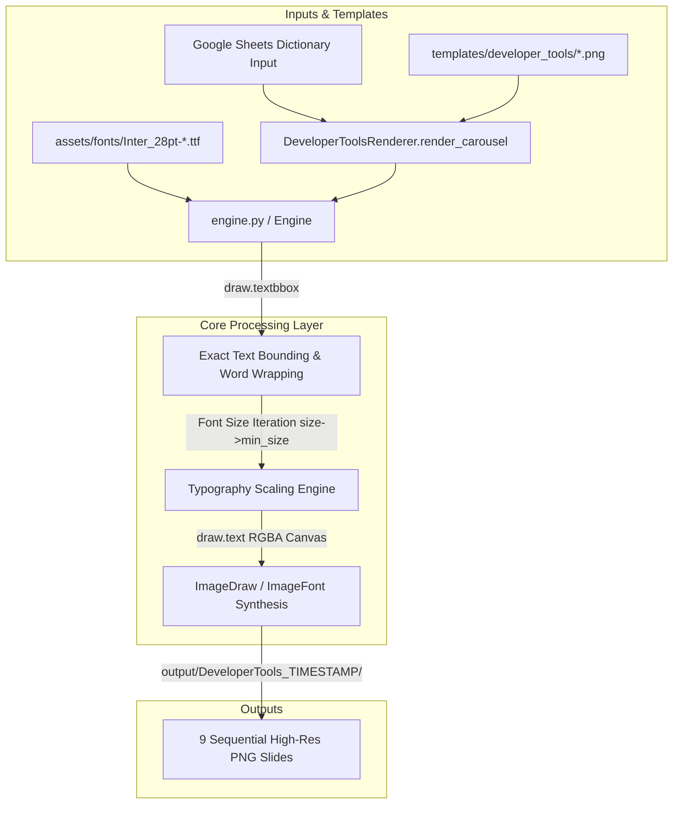
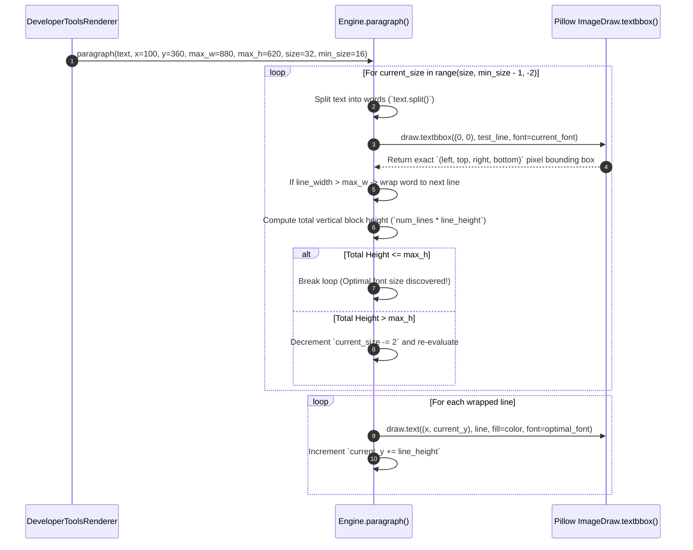

# Visual Rendering Engine & Typography Canvas Architecture (`Renderer.md`)

**Document ID:** HDT-REND-001  
**Category:** Rendering Specifications  
**Version:** 1.0  
**Status:** Canonical Engineering Baseline  
**Cross-References:** [ADR-001 Renderer Isolation](file:///e:/Vinitt/HiddenDevTools/HiddenDevTools-Engine/docs/02_Architecture/ADR-001_Renderer_Isolation.md), [Backend](file:///e:/Vinitt/HiddenDevTools/HiddenDevTools-Engine/docs/03_Backend/Backend.md), [Configuration](file:///e:/Vinitt/HiddenDevTools/HiddenDevTools-Engine/docs/03_Backend/Configuration.md)

---

## 1. Subsystem Overview & Architectural Boundaries

The rendering engine inside `HiddenDevTools-Engine` is an isolated, deterministic graphic synthesis pipeline responsible for converting raw structured text from Google Sheets (`row: Dict[str, Any]`) into nine (9) sequentially numbered `1080x1350` RGBA image slides (`01_Cover.png` through `09_CTA.png`).



### Mandatory Isolation Contract (`ADR-001`)
* **Input Interface:** `DeveloperToolsRenderer.render_carousel(row: Dict[str, Any], post_name: str) -> str`.
* **Output Interface:** Writes directly to the filesystem (`output/DeveloperTools_TIMESTAMP/01_Cover.png` .. `09_CTA.png`) and returns the absolute directory path string.
* **Network Immunity:** The renderer possesses zero imports or dependencies related to `requests`, `gspread`, `supabase`, or `instagram_service`. It executes 100% offline using `Pillow` (`PIL.Image`, `PIL.ImageDraw`, `PIL.ImageFont`).

---

## 2. Core Rendering Classes & Hierarchy

### 2.1 Abstract Base Class: `BaseRenderer` ([renderers/base_renderer.py:L1-L25](file:///e:/Vinitt/HiddenDevTools/HiddenDevTools-Engine/renderers/base_renderer.py#L1-L25))
Defines the strict architectural interface all domain renderers must inherit:
```python
class BaseRenderer(ABC):
    @abstractmethod
    def render_carousel(self, row: Dict[str, Any], post_name: str) -> str:
        """Render multi-slide carousel and return output folder path."""
        pass
```

### 2.2 Domain Renderer: `DeveloperToolsRenderer` ([renderers/developer_tools_renderer.py:L12-L135](file:///e:/Vinitt/HiddenDevTools/HiddenDevTools-Engine/renderers/developer_tools_renderer.py#L12-L135))
Orchestrates the 9-slide visual layout for open-source developer tool breakdowns:
* **Slide 01 (`01_Cover.png`):** Loads `01_Cover_Template.png`. Renders `Category` badge (`y=300`), tool `Name` (`y=420`, font_size=72 bold), and `Tagline` (`y=740`, font_size=36 regular).
* **Slide 02 (`02_Problem.png`):** Loads `02_Problem_Template.png`. Renders `"The Problem"` section title (`y=180`) and problem breakdown (`y=360`).
* **Slide 03 (`03_Solution.png`):** Loads `03_Solution_Template.png`. Renders `"The Solution"` section title (`y=180`) and value proposition (`y=360`).
* **Slide 04..07 (`04_Feature1.png` to `07_Feature4.png`):** Loads `04_Content_Template.png`. Renders specific technical features, command syntax (`Code Snippet`), and execution benchmarks.
* **Slide 08 (`08_Code.png`):** Loads `08_Code_Template.png`. Renders code block / installation instructions (`pip install ...`, `npx ...`).
* **Slide 09 (`09_CTA.png`):** Loads `09_CTA_Template.png`. Renders call-to-action text (`"Comment DEV for Direct Link & GitHub Repo"`).

---

## 3. Core Typography & Canvas Synthesis Mechanics (`Engine`)

### 3.1 `Engine` Class Initialization & Font Caching ([engine.py:L13-L45](file:///e:/Vinitt/HiddenDevTools/HiddenDevTools-Engine/engine.py#L13-L45))
The core canvas drawing wrapper (`Engine`) encapsulates an `ImageDraw.Draw` instance bound to an active `Image.Image` background canvas:
```python
class Engine:
    def __init__(self, template_path: str):
        self.image = Image.open(template_path).convert("RGBA")
        self.draw = ImageDraw.Draw(self.image)
        self.font_cache: Dict[Tuple[str, int], ImageFont.FreeTypeFont] = {}
```
To avoid expensive TrueType font file loading on every text draw call, `get_font(font_name, size)` caches `ImageFont.truetype(font_path, size)` instances inside `self.font_cache`.

### 3.2 Dynamic Word Wrapping & Bounding Box Calculation (`paragraph()`) ([engine.py:L70-L155](file:///e:/Vinitt/HiddenDevTools/HiddenDevTools-Engine/engine.py#L70-L155))
When rendering multi-line technical descriptions (`paragraph()`), the engine must enforce precise coordinate bounding boxes (`x, y, max_width, max_height`) without clipping:



### 3.3 Exact Pillow Coordinate Bounding Logic
Unlike legacy `ImageDraw.textsize` (deprecated in Pillow 10.0+), `draw.textbbox((0, 0), text, font)` returns a 4-tuple `(x0, y0, x1, y1)` accounting for exact TrueType ascenders, descenders, and kerning pairs. The exact line width is computed as:
```python
bbox = self.draw.textbbox((0, 0), test_line, font=font)
line_width = bbox[2] - bbox[0]
line_height = (bbox[3] - bbox[1]) + line_spacing_padding
```

---

## 4. Typography Assets & Color Palette

### 4.1 TrueType Typography Directory (`assets/fonts/`)
The system mandates using exact TrueType font files stored locally to eliminate OS-level font differences:
* **Bold Font (`assets/fonts/Inter_28pt-Bold.ttf`):** Used for Slide Titles (`font_size=72`, `48`), Category Badges (`font_size=28`), and Pricing Badges.
* **Regular Font (`assets/fonts/Inter_28pt-Regular.ttf`):** Used for Taglines (`font_size=36`), Problem/Solution descriptions (`font_size=32`), and Code Snippet text (`font_size=24`).

### 4.2 Standardized RGBA Color Palette (`config.py`)
All draw methods use strict RGB tuples (`fill=COLOR_TOKEN`):
* `COLOR_TEXT_PRIMARY = (255, 255, 255)` — Crisp white for primary headers and body text against dark backgrounds.
* `COLOR_TEXT_MUTED = (148, 163, 184)` — Slate-400 for secondary taglines and metadata.
* `COLOR_ACCENT_BLUE = (37, 99, 235)` — Blue-600 used for category tags and CTA highlight buttons.

---

## 5. Performance Benchmarks & Concurrency Safety

* **Execution Speed:** Synthesizing all 9 high-resolution (`1080x1350`) RGBA slides completes in `< 1.2 seconds` on standard x86/ARM64 compute threads, well under the `NFR-01` `< 15 seconds` target threshold.
* **Async Event-Loop Protection (`services/generation_service.py`):** Because `Pillow` image manipulation (`Image.open`, `ImageDraw.text`) is a synchronous, CPU-bound operation, running it directly inside an `async def` FastAPI endpoint would block the master event loop. Therefore, `GenerationService.generate_carousel_async()` ([services/generation_service.py:L40-L65](file:///e:/Vinitt/HiddenDevTools/HiddenDevTools-Engine/services/generation_service.py#L40-L65)) executes the synchronous renderer inside a separate background thread:
  ```python
  output_dir = await asyncio.to_thread(
      self.renderer.render_carousel, row, post_name
  )
  ```
