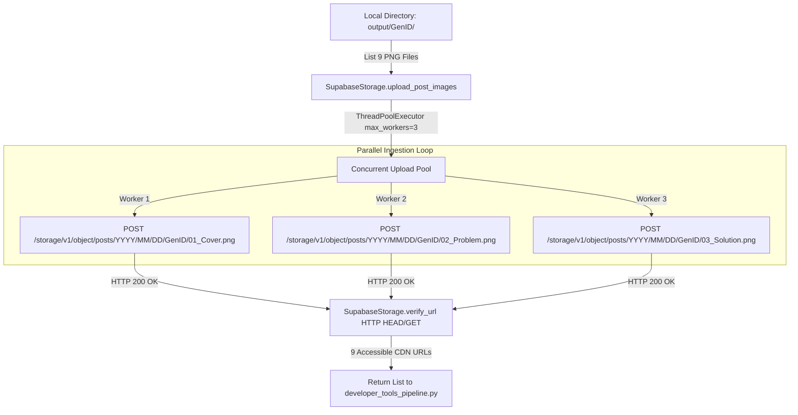
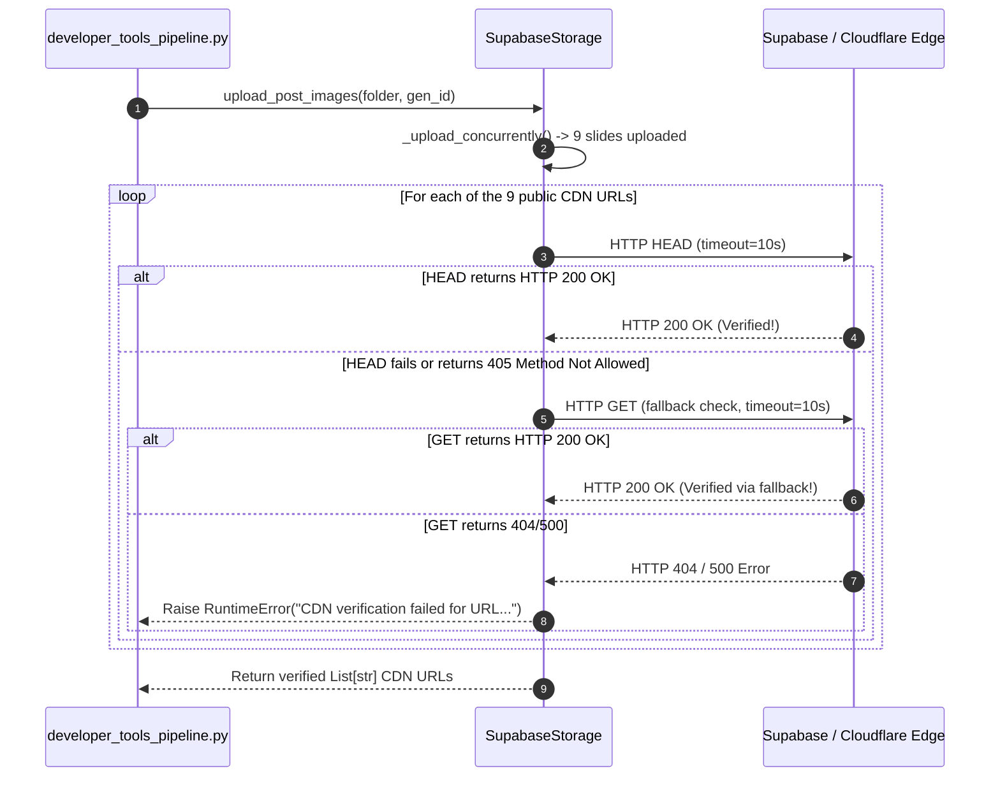

# Supabase Storage Integration & Multi-Threaded Ingestion (`Supabase_Integration.md`)

**Document ID:** HDT-PUB-002  
**Category:** Publishing Specifications  
**Version:** 1.0  
**Status:** Canonical Engineering Baseline  
**Cross-References:** [Publishing](file:///e:/Vinitt/HiddenDevTools/HiddenDevTools-Engine/docs/05_Publishing/Publishing.md), [ADR-004](file:///e:/Vinitt/HiddenDevTools/HiddenDevTools-Engine/docs/02_Architecture/ADR-004_Supabase_Storage.md), [Configuration](file:///e:/Vinitt/HiddenDevTools/HiddenDevTools-Engine/docs/03_Backend/Configuration.md)

---

## 1. Subsystem Overview & Architectural Purpose

Because Meta Graph API v23.0 carousel container creation endpoints (`POST /{ig_user_id}/media`) strictly require public HTTPS image URLs (`image_url`), local PNG files generated by `DeveloperToolsRenderer` (`output/GenID/*.png`) must be uploaded to a reliable, global CDN prior to initiating Graph API calls.

`SupabaseStorage` (`services/storage_service.py`) acts as the dedicated cloud object storage adapter for `HiddenDevTools-Engine`. It utilizes direct HTTP REST POST endpoints against Supabase Storage buckets (`STORAGE_BUCKET_POSTS`), executes multi-threaded concurrent uploads (`ThreadPoolExecutor max_workers=3`), applies explicit MIME caching headers (`cacheControl: 3600`), and verifies CDN URL reachability (`verify_url`) before returning asset URLs to the orchestrator.



---

## 2. Bucket Organization & Path Structuring

Supabase Storage files are organized cleanly inside the `posts` bucket (`STORAGE_BUCKET_POSTS`) using date and generation ID partitions:

```
Bucket: posts/
└── YYYY/
    └── MM/
        └── DD/
            └── GenID/                     # e.g., Post_012 or DeveloperTools_20260710
                ├── 01_Cover.png
                ├── 02_Problem.png
                ├── 03_Solution.png
                ├── 04_Feature1.png
                ├── 05_Feature2.png
                ├── 06_Feature3.png
                ├── 07_Feature4.png
                ├── 08_Code.png
                └── 09_CTA.png
```

### Public CDN URL Formula
For any uploaded file, `_get_public_url(remote_path)` ([services/storage_service.py:L115-L125](file:///e:/Vinitt/HiddenDevTools/HiddenDevTools-Engine/services/storage_service.py#L115-L125)) constructs the canonical Cloudflare-backed CDN URL:
```python
public_url = f"{self.supabase_url}/storage/v1/object/public/{self.bucket}/{remote_path}"
```

---

## 3. Parallel Multi-Threaded Upload Engine (`_upload_concurrently`)

Sequential uploading of 9 high-resolution (`1080x1350`) PNG images (~800KB each) over single HTTP connections averages `12–18 seconds` total network latency. To eliminate this bottleneck, `_upload_concurrently()` ([services/storage_service.py:L130-L160](file:///e:/Vinitt/HiddenDevTools/HiddenDevTools-Engine/services/storage_service.py#L130-L160)) leverages a thread pool:

```python
with concurrent.futures.ThreadPoolExecutor(max_workers=3) as executor:
    future_to_file = {
        executor.submit(self._upload_single, file_path, remote_path): file_path
        for file_path, remote_path in upload_tasks
    }
    for future in concurrent.futures.as_completed(future_to_file):
        future.result() # Raises exception immediately if any worker failed
```
* **Why `max_workers=3`?** Limiting concurrency to 3 simultaneous worker threads optimizes network egress bandwidth while avoiding Supabase Storage API rate-limiting thresholds or local socket exhaustion.

---

## 4. Single-File Upload Mechanics (`_upload_single`)

Each worker thread executes `_upload_single(local_file_path, remote_path)` ([services/storage_service.py:L70-L112](file:///e:/Vinitt/HiddenDevTools/HiddenDevTools-Engine/services/storage_service.py#L70-L112)), which performs a direct binary HTTP POST against the REST endpoint:

```python
endpoint = f"{self.supabase_url}/storage/v1/object/{self.bucket}/{remote_path}"
headers = {
    "Authorization": f"Bearer {self.service_key}",
    "Content-Type": "image/png",
    "cacheControl": "3600",
    "x-upsert": "true" # Overwrite if exact file path already exists
}

with open(local_file_path, "rb") as f:
    response = requests.post(endpoint, headers=headers, data=f, timeout=30)
```
* **MIME Enforcement:** `Content-Type: image/png` ensures Meta Graph API crawlers immediately recognize the payload as a valid PNG raster image without relying on filename extensions.
* **Cache Control:** `cacheControl: 3600` instructs Cloudflare edge servers to cache the slide asset for 1 hour, guaranteeing fast container downloading across Meta's distributed ingestion centers.

---

## 5. Mandatory Pre-Publish CDN Reachability Verification (`verify_url`)

Even after an upload returns `HTTP 200 OK`, propagation across Cloudflare CDN edge nodes can occasionally experience minor sub-second delays. If `InstagramService.create_media_container()` requests a URL during an edge cache miss (`404 Not Found`), Graph API permanently fails the slide container.

To prevent container failures, `verify_url(url)` ([services/storage_service.py:L162-L195](file:///e:/Vinitt/HiddenDevTools/HiddenDevTools-Engine/services/storage_service.py#L162-L195)) enforces programmatic verification prior to returning the list of URLs to the pipeline:


