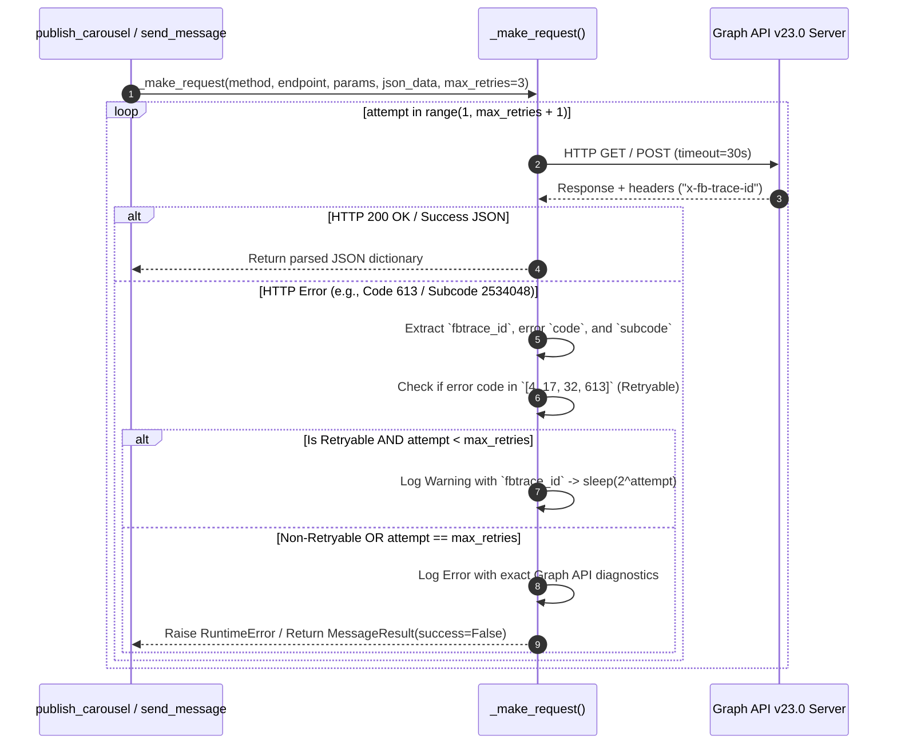

# Meta Graph API v23.0 Carousel & Messaging Adapter (`Instagram.md`)

**Document ID:** HDT-IG-001  
**Category:** Instagram Specifications  
**Version:** 1.0  
**Status:** Canonical Engineering Baseline  
**Cross-References:** [ADR-005](file:///e:/Vinitt/HiddenDevTools/HiddenDevTools-Engine/docs/02_Architecture/ADR-005_Instagram_Graph_API.md), [Publishing](file:///e:/Vinitt/HiddenDevTools/HiddenDevTools-Engine/docs/05_Publishing/Publishing.md), [Failures Analysis](file:///e:/Vinitt/HiddenDevTools/HiddenDevTools-Engine/docs/reports/Failures.md), [Configuration](file:///e:/Vinitt/HiddenDevTools/HiddenDevTools-Engine/docs/03_Backend/Configuration.md)

---

## 1. Subsystem Overview & API Authentication

`InstagramService` ([services/instagram_service.py:L45-L780](file:///e:/Vinitt/HiddenDevTools/HiddenDevTools-Engine/services/instagram_service.py#L45-L780)) is the canonical network client responsible for all communication with Meta Graph API `v23.0` (`https://graph.facebook.com/v23.0`). It encapsulates two distinct business domains:
1. **Asynchronous Multi-Slide Carousel Publishing:** Creating item containers, polling processing statuses, assembling parent carousel containers, triggering grid publishing, and verifying canonical permalinks.
2. **Real-Time Direct Messaging (DMs):** Sending automated 1-on-1 direct messages containing repository URLs (`send_message`) to users who comment `DEV` on published carousel posts.

### Authentication & Required OAuth Scope
All Graph API requests must authenticate via a long-lived **Facebook Page / Instagram Business Access Token** (`INSTAGRAM_ACCESS_TOKEN`) passed as a query or body parameter (`access_token=...`).

The access token must possess four mandatory permissions granted during Facebook Login or Graph Explorer exchange:
* `instagram_basic` — Reading profile metadata, checking container status codes, and fetching post permalinks.
* `instagram_content_publish` — Creating media containers and triggering grid publications (`/{ig_user_id}/media_publish`).
* `instagram_manage_comments` — Receiving real-time comment webhooks and fetching comment metadata (`/{comment_id}`).
* `instagram_manage_messages` — Sending Direct Messages via `POST /{page_id}/messages` (Requires App Review for public access).

---

## 2. Core Network Helper: `_make_request` & Exponential Backoff

To protect against Meta API rate limits (`Code 613`) and transient server failures (`Code 4, 17, 32`), all HTTP traffic must pass through `_make_request()` ([services/instagram_service.py:L80-L200](file:///e:/Vinitt/HiddenDevTools/HiddenDevTools-Engine/services/instagram_service.py#L80-L200)).



---

## 3. Asynchronous 3-Stage Carousel Publishing Flow

Publishing a 9-slide carousel (`publish_carousel()`) ([services/instagram_service.py:L604-L779](file:///e:/Vinitt/HiddenDevTools/HiddenDevTools-Engine/services/instagram_service.py#L604-L779)) strictly follows Meta's asynchronous 3-stage container specification:

```mermaid
graph TD
    Input[List of 9 CDN Image URLs + Caption] --> Stage1[Stage 1: create_media_container x 9 slides]
    subgraph Stage 1: Item Container Creation
        Stage1 -->|POST /{ig_user_id}/media image_url=URL is_carousel_item=true| C1[Container ID 1..9]
    end
    C1 --> Stage2[Stage 2: wait_for_container Polling Loop]
    subgraph Stage 2: Container Polling
        Stage2 -->|GET /{container_id}?fields=status_code| StatusCheck{Status == FINISHED?}
        StatusCheck -->|IN_PROGRESS| SleepPoll[Sleep 3 seconds & retry max 120s]
        SleepPoll --> StatusCheck
        StatusCheck -->|ERROR / EXPIRED| RaiseContainerErr[Raise RuntimeError Container Processing Failed]
    end
    StatusCheck -->|All 9 FINISHED| Stage3[Stage 3: create_carousel & publish]
    subgraph Stage 3: Carousel Assembly & Publishing
        Stage3 -->|POST /{ig_user_id}/media media_type=CAROUSEL children=id1..id9 caption=...| ParentID[Parent Carousel Container ID]
        ParentID -->|wait_for_container Parent ID| ParentStatus{Parent FINISHED?}
        ParentStatus -->|Yes| GridPublish[POST /{ig_user_id}/media_publish creation_id=ParentID]
        GridPublish -->|HTTP 200 OK id=media_id| Verify[verify_publication & get_permalink]
    end
    Verify -->|GET /{media_id}?fields=permalink| Result[Return success=True, media_id, permalink]
```

### Exact Endpoint Parameter Matrix

| Method Name (`InstagramService`) | Graph API v23.0 HTTP Endpoint | Required Query / Body Parameters | Expected Response Payload |
| :--- | :--- | :--- | :--- |
| `create_media_container(image_url)` | `POST /{INSTAGRAM_BUSINESS_ACCOUNT_ID}/media` | `image_url: str`<br>`is_carousel_item: true`<br>`access_token: str` | `{"id": "18092834... (Item Container ID)"}` |
| `check_container_status(container_id)` | `GET /{container_id}` | `fields: "status_code"`<br>`access_token: str` | `{"id": "...", "status_code": "FINISHED"}` (or `IN_PROGRESS`, `ERROR`) |
| `create_carousel(container_ids, caption)` | `POST /{INSTAGRAM_BUSINESS_ACCOUNT_ID}/media` | `media_type: "CAROUSEL"`<br>`children: "id1,id2,id3..."`<br>`caption: str`<br>`access_token: str` | `{"id": "18104928... (Parent Container ID)"}` |
| `publish(creation_id)` | `POST /{INSTAGRAM_BUSINESS_ACCOUNT_ID}/media_publish` | `creation_id: str (Parent Container ID)`<br>`access_token: str` | `{"id": "17909400... (Published Media ID)"}` |
| `get_permalink(media_id)` | `GET /{media_id}` | `fields: "permalink"`<br>`access_token: str` | `{"id": "...", "permalink": "https://www.instagram.com/p/C..."}` |

---

## 4. Direct Messaging API Mechanics (`send_message`)

When `DMWorker.process_queue()` claims a pending comment, it calls `InstagramService.send_message(recipient_id, text)` ([services/instagram_service.py:L205-L267](file:///e:/Vinitt/HiddenDevTools/HiddenDevTools-Engine/services/instagram_service.py#L205-L267)):

```python
endpoint = f"https://graph.facebook.com/{self.api_version}/{self.page_id}/messages"
payload = {
    "recipient": {"id": recipient_id},  # Instagram Scoped User ID (IGSID)
    "message": {"text": text},
    "messaging_type": "RESPONSE"        # Adheres to 24-hour customer service window
}
params = {"access_token": self.access_token}

response = self._make_request("POST", endpoint, params=params, json_data=payload)
```

### Direct Messaging Error Analysis & App Review (`Code 200 / Subcode 2534048`)
When operating in **Standard Access** (Development Mode), sending DMs to public users who are not registered App Testers fails with:
```json
{
  "error": {
    "message": "(#200) App does not have Advanced Access to instagram_manage_messages permission.",
    "type": "OAuthException",
    "code": 200,
    "error_subcode": 2534048,
    "fbtrace_id": "Gv4OXdKH+ka"
  }
}
```
* **Operational Handling:** `send_message()` intercepts `subcode == 2534048` or `code == 200`, sets `MessageResult(success=False, retryable=False, error_message="...")`, and signals `DMWorker` to transition the comment directly to `FAILED` (`DM_FAILED_PERMISSION`) without executing useless retry backoffs.
* **Graduation Path:** To graduate to **Advanced Access**, the engineering team must submit a 2-minute screen recording in the Meta App Dashboard (`instagram_manage_messages`), demonstrating the automated comment reply flow working correctly between test accounts (`@hiddendevtools` and `@vinit.surve.pvt`).
