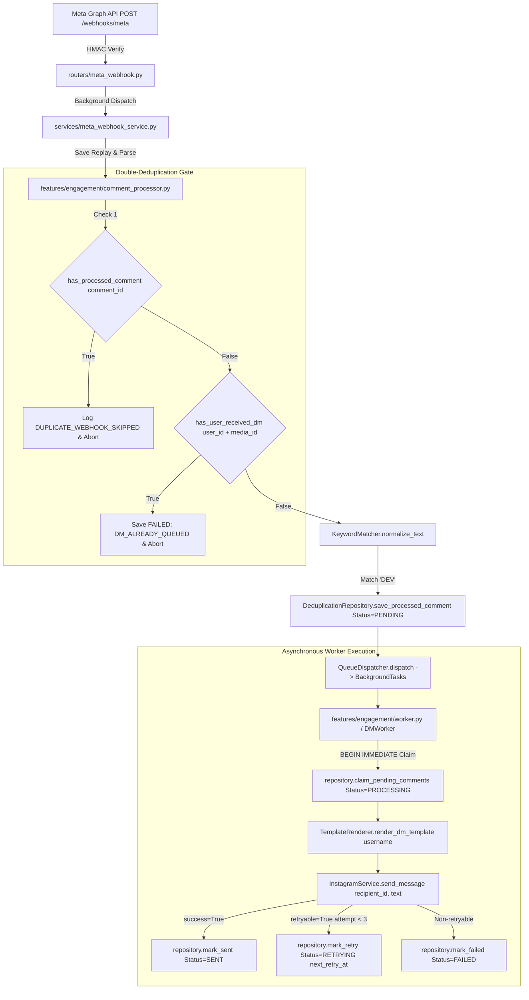
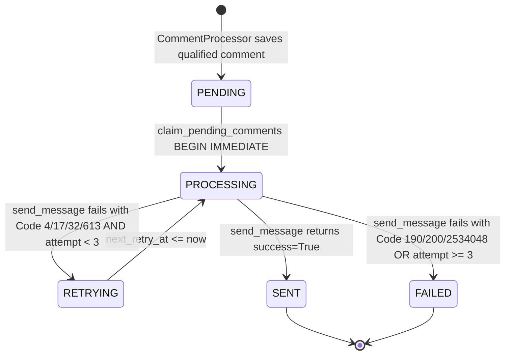

# Interactive Community Engagement & Direct Messaging Loop (`Engagement.md`)

**Document ID:** HDT-ENG-001  
**Category:** Engagement Specifications  
**Version:** 1.0  
**Status:** Canonical Engineering Baseline  
**Cross-References:** [ADR-002](file:///e:/Vinitt/HiddenDevTools/HiddenDevTools-Engine/docs/02_Architecture/ADR-002_Repository_Pattern.md), [ADR-006](file:///e:/Vinitt/HiddenDevTools/HiddenDevTools-Engine/docs/02_Architecture/ADR-006_Feature_Based_Architecture.md), [ADR-009](file:///e:/Vinitt/HiddenDevTools/HiddenDevTools-Engine/docs/02_Architecture/ADR-009_Queue_Design.md), [Database Specifications](file:///e:/Vinitt/HiddenDevTools/HiddenDevTools-Engine/docs/08_Database/Database.md), [Instagram Specifications](file:///e:/Vinitt/HiddenDevTools/HiddenDevTools-Engine/docs/06_Instagram/Instagram.md)

---

## 1. Subsystem Overview & Feature Encapsulation (`ADR-006`)

The interactive engagement pipeline (`features/engagement/`) turns incoming Instagram audience comments (`DEV`) into immediate, personalized 1-on-1 Direct Messages (`DMWorker`) containing exact repository URLs.



---

## 2. Webhook Reception & Cryptographic HMAC Verification

When an Instagram user comments on a post, Meta servers dispatch an HTTP `POST /webhooks/meta` request carrying the comment properties inside an `entry -> changes -> value` JSON hierarchy.

### HMAC-SHA256 Signature Validation (`validate_signature`)
Before parsing the body, `MetaWebhookService.validate_signature(raw_body, signature_header)` ([services/meta_webhook_service.py:L40-L63](file:///e:/Vinitt/HiddenDevTools/HiddenDevTools-Engine/services/meta_webhook_service.py#L40-L63)) cryptographically verifies message integrity:
```python
if config.is_development():
    return True # Bypasses check during local development/mock testing

expected_signature = "sha256=" + hmac.new(
    config.META_APP_SECRET.encode("utf-8"),
    raw_body,
    hashlib.sha256
).hexdigest()

return hmac.compare_digest(expected_signature, signature_header)
```
If verification passes, `routers/meta_webhook.py` immediately returns `HTTP 200 OK` (`{"status": "ok"}`) within `< 200ms` (`AC-501`) and pushes the payload onto `FastAPI.BackgroundTasks`.

---

## 3. Double-Deduplication Defense (`CommentProcessor`)

Meta webhooks guarantee *at-least-once* delivery, meaning the exact same comment event (`comment_id`) can arrive two or three times if network latencies cause Meta to retry before receiving the server's `200 OK`. Furthermore, enthusiastic users often comment `DEV` multiple times across different slides of the same carousel.

To guarantee zero duplicate DMs, `CommentProcessor.process_event(event: WebhookEvent)` ([features/engagement/comment_processor.py:L24-L55](file:///e:/Vinitt/HiddenDevTools/HiddenDevTools-Engine/features/engagement/comment_processor.py#L24-L55)) enforces two sequential barriers inside `DeduplicationRepository`:

```python
# Barrier 1: Check if this exact comment ID arrived previously
if self.repository.has_processed_comment(event.comment_id):
    logger.info(f"[{correlation_id}] DUPLICATE_WEBHOOK_SKIPPED: Already processed {event.comment_id}")
    return

# Barrier 2: Check if this user already received a DM for this specific carousel post
if self.repository.has_user_received_dm(event.user_id, event.media_id):
    logger.info(f"[{correlation_id}] DM_ALREADY_QUEUED: User {event.username} already engaged with post {event.media_id}")
    self.repository.save_processed_comment(
        ProcessedComment(
            comment_id=event.comment_id,
            media_id=event.media_id,
            user_id=event.user_id,
            username=event.username,
            original_text=event.text,
            normalized_text=normalized_text,
            status=DMStatus.FAILED, # Recorded as FAILED to prevent worker pickup
            last_error="User already received DM for this post."
        )
    )
    return
```

---

## 4. Keyword Normalization & Matching Engine (`KeywordMatcher`)

Raw comments from mobile devices often contain extra trailing spaces, emojis (`🚀 DEV 🔥`), or punctuation (`DEV!!!!`). `KeywordMatcher.normalize_text(text)` ([features/engagement/keyword_matcher.py:L15-L28](file:///e:/Vinitt/HiddenDevTools/HiddenDevTools-Engine/features/engagement/keyword_matcher.py#L15-L28)) standardizes text before matching:

```python
# Strip accents, uppercase all letters, remove punctuation and emojis
text = unicodedata.normalize("NFKD", text).encode("ascii", "ignore").decode("utf-8")
text = re.sub(r"[^\w\s]", "", text).upper().strip()
```
`match_keyword()` then verifies if any token inside `normalized_text` matches `config.ENGAGEMENT_KEYWORDS` (`["DEV", "TOOLS", "LINK"]`). If a match occurs, `CommentProcessor` saves the record as `DMStatus.PENDING` (`save_processed_comment`) and triggers `dispatcher.dispatch(comment_id)`.

---

## 5. Concurrency-Safe Worker Claiming & Exponential Backoff (`DMWorker`)

When `DMWorker.process_queue()` ([features/engagement/worker.py:L28-L69](file:///e:/Vinitt/HiddenDevTools/HiddenDevTools-Engine/features/engagement/worker.py#L28-L69)) executes, it first claims up to `WORKER_BATCH_SIZE (10)` actionable records by calling `repository.claim_pending_comments(limit=10)` ([features/engagement/repository.py:L60-L118](file:///e:/Vinitt/HiddenDevTools/HiddenDevTools-Engine/features/engagement/repository.py#L60-L118)).

### 5.1 SQLite `BEGIN IMMEDIATE` Transactional Lock
To prevent two concurrent background threads from claiming the same `PENDING` comment, `claim_pending_comments` immediately opens an exclusive write transaction:
```python
conn = sqlite3.connect(self.db_path, timeout=30.0)
conn.execute("BEGIN IMMEDIATE") # Acquires exclusive write lock immediately

cursor = conn.cursor()
cursor.execute("""
    SELECT comment_id, media_id, user_id, username, original_text, normalized_text,
           status, created_at, processed_at, attempt_count, last_attempt_at, last_error, next_retry_at
    FROM processed_comments
    WHERE status = 'PENDING'
       OR (status = 'PROCESSING' AND last_attempt_at <= datetime('now', '-60 seconds'))
       OR (status = 'RETRYING' AND next_retry_at <= datetime('now'))
    LIMIT ?
""", (limit,))
rows = cursor.fetchall()

# Immediately transition claimed rows to PROCESSING before releasing the lock
for row in rows:
    conn.execute("""
        UPDATE processed_comments
        SET status = 'PROCESSING', last_attempt_at = datetime('now')
        WHERE comment_id = ?
    """, (row[0],))
conn.commit() # Lock released upon commit
```

### 5.2 Worker Execution & Exponential Backoff Evaluation
For each claimed `ProcessedComment`, `DMWorker` renders `TemplateRenderer.render_dm_template(comment.username)` and calls `InstagramService.send_message(comment.user_id, text)`.



If `send_message()` encounters a retryable rate-limit (`MessageResult.retryable == True`), `worker.py` invokes `repository.mark_retry()`:
```python
next_retry = datetime.now() + timedelta(seconds=30 * (2 ** (comment.attempt_count - 1)))
self.repository.mark_retry(
    comment_id=comment.comment_id,
    reason=result.error_message,
    attempt_count=comment.attempt_count + 1,
    next_retry_at=next_retry
)
```
This sets `status = 'RETRYING'` and calculates exponential backoff delays (`30s`, `60s`, `120s`). If `attempt_count` exceeds `MAX_DM_RETRIES (3)`, the comment transitions permanently to `status = 'FAILED'`.
