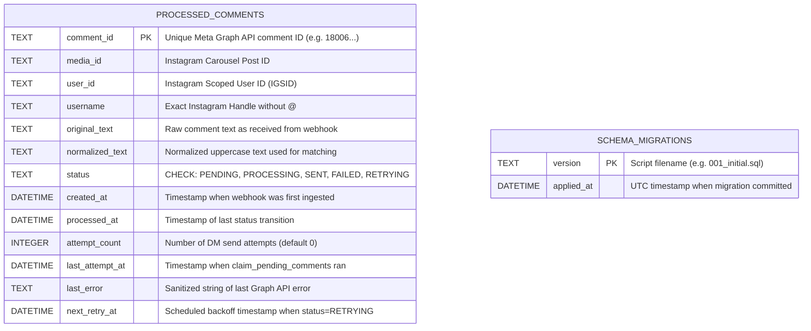
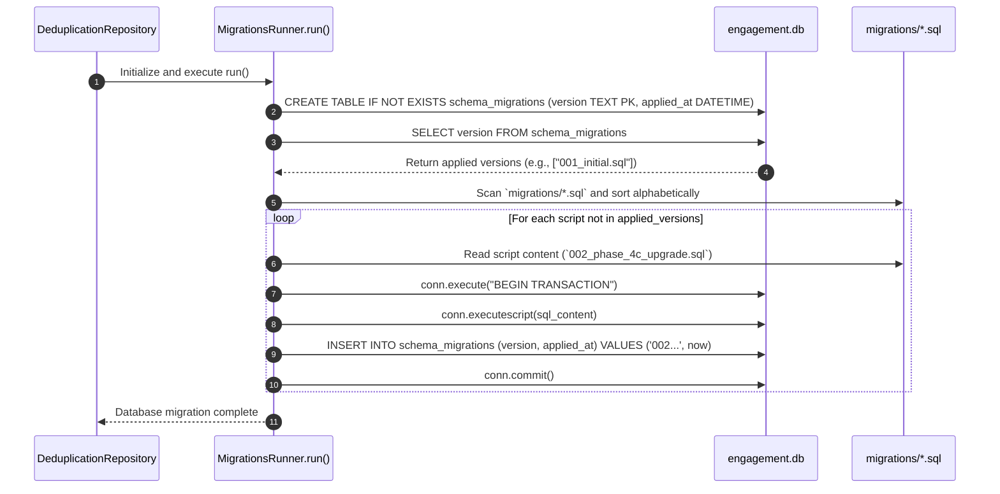

# Database Schema, Migrations & Transactional Locking Architecture (`Database.md`)

**Document ID:** HDT-DB-001  
**Category:** Database Specifications  
**Version:** 1.0  
**Status:** Canonical Engineering Baseline  
**Cross-References:** [ADR-003](file:///e:/Vinitt/HiddenDevTools/HiddenDevTools-Engine/docs/02_Architecture/ADR-003_SQLite_First.md), [ADR-010](file:///e:/Vinitt/HiddenDevTools/HiddenDevTools-Engine/docs/02_Architecture/ADR-010_Migration_Strategy.md), [Engagement Specifications](file:///e:/Vinitt/HiddenDevTools/HiddenDevTools-Engine/docs/07_Engagement/Engagement.md), [Backend](file:///e:/Vinitt/HiddenDevTools/HiddenDevTools-Engine/docs/03_Backend/Backend.md)

---

## 1. Subsystem Overview & Embedded SQLite Engine (`ADR-003`)

The canonical state store for `HiddenDevTools-Engine` (`e:\Vinitt\HiddenDevTools\HiddenDevTools-Engine\engagement.db`) is an embedded, ACID-compliant **SQLite 3** relational database. It is managed by `DeduplicationRepository` ([features/engagement/repository.py](file:///e:/Vinitt/HiddenDevTools/HiddenDevTools-Engine/features/engagement/repository.py)) and automatically migrated on initialization via `MigrationsRunner` ([features/engagement/migrations_runner.py](file:///e:/Vinitt/HiddenDevTools/HiddenDevTools-Engine/features/engagement/migrations_runner.py)).

---

## 2. Entity-Relationship (ER) Schema & Table Specifications



### Table 1: `processed_comments`
Core operational tracking table for every comment event processed across `@hiddendevtools` carousels.

| Column Name | SQL Data Type | Nullable | Default Value | Constraints & Indices | Description & Operational Role |
| :--- | :--- | :--- | :--- | :--- | :--- |
| `comment_id` | `TEXT` | `NOT NULL` | N/A | **PRIMARY KEY** | Unique Meta comment ID (`18347...`). Enforces Barrier 1 deduplication (`has_processed_comment`). |
| `media_id` | `TEXT` | `NOT NULL` | N/A | `INDEX idx_user_media` | Target carousel post ID (`18126...`). Used in `idx_user_media` composite check. |
| `user_id` | `TEXT` | `NOT NULL` | N/A | `INDEX idx_user_media` | Instagram Scoped User ID (`IGSID`). Enforces Barrier 2 deduplication (`has_user_received_dm`). |
| `username` | `TEXT` | `NOT NULL` | N/A | None | Commenter's public username (`vinit.surve.pvt`). Injected into `DM_TEMPLATE`. |
| `original_text` | `TEXT` | `NOT NULL` | N/A | None | Exact raw comment text as received (`DEV🚀`). |
| `normalized_text` | `TEXT` | `NOT NULL` | N/A | None | Cleaned uppercase tokens (`DEV`). Verified against `ENGAGEMENT_KEYWORDS`. |
| `status` | `TEXT` | `NOT NULL` | `'PENDING'` | `CHECK status IN (...)`<br>`INDEX idx_status_retry` | Current lifecycle state: `PENDING`, `PROCESSING`, `SENT`, `FAILED`, `RETRYING`. |
| `created_at` | `DATETIME` | `NOT NULL` | `CURRENT_TIMESTAMP` | None | Initial webhook reception timestamp. |
| `processed_at` | `DATETIME` | `NULL` | `NULL` | None | Updated every time `status` transitions (`PROCESSING`, `SENT`, `FAILED`). |
| `attempt_count` | `INTEGER` | `NOT NULL` | `0` | None | Counter incremented upon every `claim_pending_comments` or `mark_retry` cycle. |
| `last_attempt_at` | `DATETIME` | `NULL` | `NULL` | None | Timestamp when row was locked to `PROCESSING`. Used for 60s timeout recovery. |
| `last_error` | `TEXT` | `NULL` | `NULL` | None | Diagnostic error message (`Code 190 Session Expired`, `Code 200 Subcode 2534048`). |
| `next_retry_at` | `DATETIME` | `NULL` | `NULL` | `INDEX idx_status_retry` | Exponential backoff trigger timestamp (`now + 30 * 2^(attempt-1)`). |

---

## 3. Automated Sequential Migration Engine (`MigrationsRunner`)

When `server.py` boots or when tests run, `DeduplicationRepository.__init__()` immediately calls `MigrationsRunner(self.db_path).run()` ([features/engagement/migrations_runner.py:L15-L53](file:///e:/Vinitt/HiddenDevTools/HiddenDevTools-Engine/features/engagement/migrations_runner.py#L15-L53)).



### Script Catalog & DDL History
1. **`migrations/001_initial.sql` ([migrations/001_initial.sql:L1-L11](file:///e:/Vinitt/HiddenDevTools/HiddenDevTools-Engine/migrations/001_initial.sql#L1-L11)):** Establishes initial Phase 4 table (`processed_comments` with 7 columns) and basic index `idx_processed_comments_user_media (user_id, media_id)`.
2. **`migrations/002_phase_4c_upgrade.sql` ([migrations/002_phase_4c_upgrade.sql:L1-L19](file:///e:/Vinitt/HiddenDevTools/HiddenDevTools-Engine/migrations/002_phase_4c_upgrade.sql#L1-L19)):** Upgrades to Phase 4C schema using SQLite **Table Rebuild Pattern**:
   * Creates `processed_comments_new` containing `attempt_count`, `last_attempt_at`, `last_error`, `next_retry_at`, and expanded `status CHECK` constraints (`RETRYING`).
   * Copies existing rows (`INSERT INTO processed_comments_new SELECT ...`).
   * Drops old table (`DROP TABLE processed_comments`) and renames (`ALTER TABLE processed_comments_new RENAME TO processed_comments`).
   * Creates composite indices `idx_status_retry (status, next_retry_at)` and `idx_user_media (user_id, media_id)`.

---

## 4. Concurrency & Transaction Management Rules (`BEGIN IMMEDIATE`)

In SQLite, default deferred transactions (`BEGIN DEFERRED`) open in read-only mode until a write statement executes. If two concurrent worker processes (`DMWorker`) execute `SELECT ... WHERE status='PENDING'` concurrently under deferred transactions, both read the exact same comment row. When both attempt to `UPDATE status='PROCESSING'`, SQLite throws `sqlite3.OperationalError: database is locked` (`SQLITE_BUSY`).

To completely eliminate race conditions and lock busy errors, `DeduplicationRepository.claim_pending_comments()` ([features/engagement/repository.py:L68-L118](file:///e:/Vinitt/HiddenDevTools/HiddenDevTools-Engine/features/engagement/repository.py#L68-L118)) enforces explicit reserved write locking:

```python
conn = sqlite3.connect(self.db_path, timeout=30.0)
# Mandate BEGIN IMMEDIATE to acquire exclusive write lock right at transaction start
conn.execute("BEGIN IMMEDIATE")

cursor = conn.cursor()
cursor.execute("""
    SELECT comment_id, media_id, user_id, username, original_text, normalized_text,
           status, created_at, processed_at, attempt_count, last_attempt_at, last_error, next_retry_at
    FROM processed_comments
    WHERE status = 'PENDING'
       OR (status = 'PROCESSING' AND last_attempt_at <= datetime('now', '-60 seconds'))
       OR (status = 'RETRYING' AND next_retry_at <= datetime('now'))
    LIMIT ?
""", (limit,))
rows = cursor.fetchall()

for row in rows:
    conn.execute("""
        UPDATE processed_comments
        SET status = 'PROCESSING', last_attempt_at = datetime('now'), attempt_count = attempt_count + 1
        WHERE comment_id = ?
    """, (row[0],))
conn.commit() # Releases reserved write lock cleanly upon committing batch status transition
```
