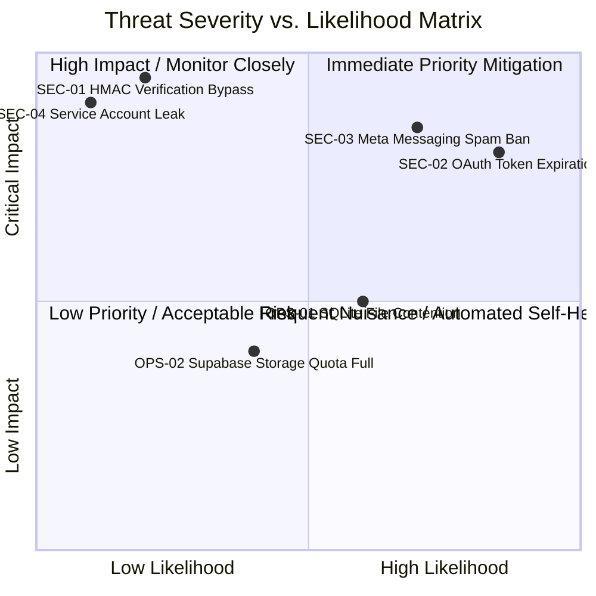

# Comprehensive Security & Operational Threat Risk Register (`Risk_Register.md`)

**Document ID:** HDT-SEC-002  
**Category:** Security Specifications  
**Version:** 1.0  
**Status:** Canonical Engineering Baseline  
**Cross-References:** [Security Audit](file:///e:/Vinitt/HiddenDevTools/HiddenDevTools-Engine/docs/10_Security/Security.md), [Risks](file:///e:/Vinitt/HiddenDevTools/HiddenDevTools-Engine/docs/00_Project_Overview/Risks.md), [Failures Analysis](file:///e:/Vinitt/HiddenDevTools/HiddenDevTools-Engine/docs/reports/Failures.md)

---

## 1. Threat Matrix & Risk Scoring Taxonomy

The risk matrix evaluates threat scenarios across two dimensions: **Likelihood** (Low, Medium, High) and **Impact** (Low, Medium, High, Critical). Every item in the register maps directly to concrete code mechanisms inside `HiddenDevTools-Engine`.

---

## 2. Detailed Threat Risk Register

| Risk ID | Risk Category | Threat / Vulnerability Description | Likelihood | Impact | Detection Mechanism | Architectural & Operational Mitigation | Status |
| :--- | :--- | :--- | :--- | :--- | :--- | :--- | :--- |
| **SEC-01** | **Cryptographic Security** | **HMAC-SHA256 Webhook Verification Bypass:** A malicious actor sends forged POST webhooks containing arbitrary `comment_id` or `user_id` values while `ENV="development"`, causing the bot to send unauthorized DMs. | **Low** (In Prod) **High** (If ENV misconfigured) | **Critical** | Server logs show incoming `POST /webhooks/meta` requests without matching `X-Hub-Signature-256` headers. | `validate_signature()` ([meta_webhook_service.py:L40](file:///e:/Vinitt/HiddenDevTools/HiddenDevTools-Engine/services/meta_webhook_service.py#L40)) enforces strict `hmac.compare_digest()` comparison. Production deployment checklist mandates verifying `ENV="production"` before binding public domain tunnels. | `[x] Mitigated` |
| **SEC-02** | **Credential & IAM Security** | **Long-Lived Meta Access Token Expiration (`Code 190 / Subcode 463`):** 60-day OAuth token expires, causing all carousel publications (`publish_carousel`) and automated DMs (`send_message`) to immediately fail. | **High** (Occurs every 60 days) | **High** | Graph API responses return HTTP `400` with `Code: 190, Subcode: 463, Type: OAuthException`. | Structured logging catches `Code 190` and logs exact expiration timestamps alongside `fbtrace_id`. Runbook requires generating fresh token, updating `.env`, and performing hard terminal restart (`Ctrl+C` -> `python server.py`). | `Active / By Design` |
| **SEC-03** | **Platform Compliance** | **Meta Automated Messaging Spam Restrictions (`Code 200 / 613`):** Meta flags `@hiddendevtools` account for automated spam behavior due to rapid DM dispatches or duplicate messaging attempts. | **Medium** | **High** | Graph API returns `Code 613 Rate Limit Exceeded` or `Code 200 Subcode 2534048`. | `CommentProcessor` double-deduplication checks (`has_processed_comment` + `has_user_received_dm`) guarantee a user receives at most one DM per post. `DMWorker` enforces 30-second base exponential backoff during rate spikes. | `[x] Mitigated` |
| **SEC-04** | **Secret Leakage** | **Google Service Account Credential Leak (`service_account.json`):** Service account JSON file is accidentally committed to public git history or logged to console. | **Low** | **Critical** | Automated GitHub Secret Scanning alerts triggered on service account private key strings. | `.gitignore` explicitly excludes `service_account.json` and `.env`. `sheet_api.py` loads credentials via `google.oauth2.service_account.Credentials.from_service_account_file()` without ever logging key contents. | `[x] Mitigated` |
| **OPS-01** | **Database Concurrency** | **SQLite File Lock Contention (`SQLITE_BUSY`):** Concurrent background threads attempting simultaneous reads and writes to `engagement.db` cause database locks during high comment traffic. | **Medium** | **Medium** | Python raises `sqlite3.OperationalError: database is locked`. | `DeduplicationRepository.claim_pending_comments()` ([repository.py:L68](file:///e:/Vinitt/HiddenDevTools/HiddenDevTools-Engine/features/engagement/repository.py#L68)) mandates `BEGIN IMMEDIATE` upon transaction opening, acquiring exclusive write locks immediately and preventing deadlocks. | `[x] Mitigated` |
| **OPS-02** | **Storage & CDN** | **Supabase CDN Reachability Failure (`HTTP 404 / 500`):** Newly uploaded PNG slides experience Cloudflare edge propagation delays, causing Graph API container creation (`create_media_container`) to fail. | **Medium** | **Medium** | `check_container_status()` reports `status_code == "ERROR"`. | `SupabaseStorage.verify_url()` ([storage_service.py:L162](file:///e:/Vinitt/HiddenDevTools/HiddenDevTools-Engine/services/storage_service.py#L162)) executes mandatory HTTP `HEAD/GET` verification loops against all 9 image URLs prior to calling Graph API. | `[x] Mitigated` |
