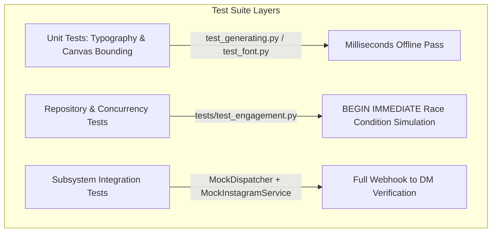

# Comprehensive Quality Assurance & Automated Testing Architecture (`Testing.md`)

**Document ID:** HDT-TEST-001  
**Category:** Testing Specifications  
**Version:** 1.0  
**Status:** Canonical Engineering Baseline  
**Cross-References:** [ADR-001](file:///e:/Vinitt/HiddenDevTools/HiddenDevTools-Engine/docs/02_Architecture/ADR-001_Renderer_Isolation.md), [ADR-002](file:///e:/Vinitt/HiddenDevTools/HiddenDevTools-Engine/docs/02_Architecture/ADR-002_Repository_Pattern.md), [Engagement Specifications](file:///e:/Vinitt/HiddenDevTools/HiddenDevTools-Engine/docs/07_Engagement/Engagement.md), [Backend](file:///e:/Vinitt/HiddenDevTools/HiddenDevTools-Engine/docs/03_Backend/Backend.md)

---

## 1. Testing Philosophy & Automated Verification Strategy

To guarantee zero regressions across high-speed visual rendering (`Engine`) and real-time community engagement (`Comment -> DM`), the `HiddenDevTools-Engine` repository (`e:\Vinitt\HiddenDevTools\HiddenDevTools-Engine`) enforces strict offline unit and integration testing.



### Core Testing Rules:
1. **Network Immunity During Tests:** Unit and integration tests (`tests/test_engagement.py`) must never make live network calls to Meta Graph API, Supabase Storage, or Google Sheets. All external adapters must be isolated using deterministic mock classes (`MockDispatcher`, `MockInstagramService`).
2. **Database Isolation:** Database tests must instantiate ephemeral SQLite databases (`test_engagement_{uuid}.db`) or in-memory connections (`:memory:`), executing `MigrationsRunner.run()` on startup and cleanly deleting temporary database files in `tearDown()`.

---

## 2. Engagement Loop Test Suite (`tests/test_engagement.py`)

The primary integration suite (`tests/test_engagement.py` ([tests/test_engagement.py:L1-L250](file:///e:/Vinitt/HiddenDevTools/HiddenDevTools-Engine/tests/test_engagement.py#L1-L250))) validates the full deduplication and messaging state machine.

### 2.1 Mock Abstractions
* **`MockDispatcher` ([tests/test_engagement.py:L20-L28](file:///e:/Vinitt/HiddenDevTools/HiddenDevTools-Engine/tests/test_engagement.py#L20-L28)):** Intercepts `dispatcher.dispatch(comment_id)` calls from `CommentProcessor` and appends `comment_id` to an internal list (`self.dispatched`), allowing assertions without requiring a running FastAPI `BackgroundTasks` loop.
* **`MockInstagramService` ([tests/test_engagement.py:L30-L45](file:///e:/Vinitt/HiddenDevTools/HiddenDevTools-Engine/tests/test_engagement.py#L30-L45)):** Simulates `send_message(recipient_id, text)` responses based on configurable state (`self.should_fail`, `self.should_rate_limit`), returning realistic `MessageResult` instances (`success=True, message_id="mid.12345"` or `retryable=True`).

### 2.2 Test Case Matrix & Coverage

| Test Method Name (`TestEngagementSubsystem`) | Target Feature / Component | Scenario Description & Verification Assertions |
| :--- | :--- | :--- |
| `test_01_successful_comment_to_dm_flow` | End-to-End Engagement Loop | Valid comment (`text="DEV"`) arrives. Asserts `CommentProcessor` saves record (`PENDING`), `MockDispatcher` receives task, `DMWorker.process_queue()` claims row (`PROCESSING` -> `SENT`), and `MockInstagramService` sends exact `DM_TEMPLATE` payload. |
| `test_02_duplicate_webhook_deduplication` | Barrier 1: Webhook Deduplication | Same `comment_id` submitted twice to `CommentProcessor`. Asserts second submission logs `DUPLICATE_WEBHOOK_SKIPPED` and `has_processed_comment()` returns `True`, ensuring `MockDispatcher.dispatched` contains only 1 item. |
| `test_03_duplicate_user_media_deduplication` | Barrier 2: User Post Deduplication | User comments `DEV` (`comment_1`) and later comments `DEV` again (`comment_2`) on the same `media_id`. Asserts first comment triggers DM (`status = SENT`). Asserts second comment is blocked (`has_user_received_dm() == True`) and recorded as `status = FAILED` (`DM_ALREADY_QUEUED`). |
| `test_04_keyword_normalization_and_matching` | `KeywordMatcher` | Submits comments with emojis and trailing spaces (`"  🚀 dev 🔥  "`, `"tools!!!!"`). Asserts `KeywordMatcher.normalize_text()` correctly strips symbols and extracts matching keywords (`DEV`, `TOOLS`). |
| `test_05_worker_retry_exponential_backoff` | `DMWorker` Backoff & Retries | Configures `MockInstagramService` to return `retryable=True` (`Code 613`). Asserts `DMWorker.process_queue()` updates row to `RETRYING` with `attempt_count=1` and `next_retry_at = now + 30s`. Verifies row is not re-claimed until `next_retry_at <= now`. |
| `test_06_claim_pending_comments_race_condition` | `BEGIN IMMEDIATE` Locking | Multi-threaded race condition simulation. Spawns 4 concurrent threads executing `claim_pending_comments(limit=10)` against the exact same SQLite connection pool. Asserts zero `sqlite3.OperationalError: database is locked` exceptions occur and every pending comment is claimed exactly once across all threads. |

---

## 3. Visual & Rendering Verification

To verify that changes to `engine.py` or font files (`assets/fonts/Inter_28pt-*.ttf`) do not break text wrapping or cause canvas overflows, `test_generating.py` and `test_font.py` execute offline canvas verification (`ADR-001`):
1. Loads dummy dictionary inputs containing variable-length descriptions (`100 chars` vs `600 chars`).
2. Invokes `DeveloperToolsRenderer().render_carousel(row, "Test_Output")`.
3. Asserts `os.path.exists("output/Test_Output/01_Cover.png")` through `09_CTA.png`.
4. Inspects generated image dimensions (`Image.open().size == (1080, 1350)`) and asserts non-zero file byte counts (`os.path.getsize() > 50000`).

---

## 4. Execution Commands & CI/CD Pipeline Integration

To execute the full engineering test suite across Windows PowerShell development environments:
```powershell
# Run the core engagement and concurrency test suite with verbose output
python -m unittest tests/test_engagement.py -v

# Run visual rendering offline verification tests
python -m unittest test_generating.py -v
```
* **CI/CD Quality Gate:** In automated integration pipelines (`GitHub Actions`), both test commands must execute and return `Exit Code 0` before any pull request merging or production server deployment (`uvicorn server:app`) is permitted.
