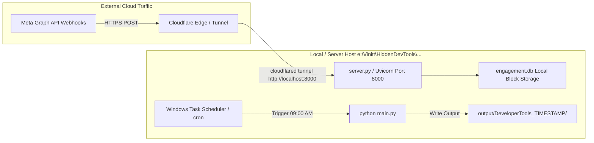

# Production & Local Deployment Runbook (`Deployment.md`)

**Document ID:** HDT-DEP-001  
**Category:** Deployment Specifications  
**Version:** 1.0  
**Status:** Canonical Engineering Baseline  
**Cross-References:** [Operations Specifications](file:///e:/Vinitt/HiddenDevTools/HiddenDevTools-Engine/docs/13_Operations/Operations.md), [Configuration](file:///e:/Vinitt/HiddenDevTools/HiddenDevTools-Engine/docs/03_Backend/Configuration.md), [Security Audit](file:///e:/Vinitt/HiddenDevTools/HiddenDevTools-Engine/docs/10_Security/Security.md)

---

## 1. Deployment Topology & System Requirements

The `HiddenDevTools-Engine` backend (`e:\Vinitt\HiddenDevTools\HiddenDevTools-Engine`) is designed to execute across Windows Server/Desktop (`PowerShell 5.1+` / `PowerShell 7+`) or Linux container environments.



### System Prerequisites
* **Operating System:** Windows 10/11 / Windows Server 2022 (`x64`) or Ubuntu 22.04 LTS (`x86_64/ARM64`).
* **Python Runtime:** Python `3.10+` (`python --version`).
* **Disk & Memory Requirements:** Minimum 2GB RAM, 15GB free storage space (for storing high-resolution PNG slide caches in `output/` prior to Drive archival).

---

## 2. Local Station Setup & Environment Initialization (PowerShell)

Execute the following PowerShell commands from the workspace root (`e:\Vinitt\HiddenDevTools\HiddenDevTools-Engine`) to bootstrap a fresh development or production deployment:

```powershell
# 1. Navigate to project root
cd e:\Vinitt\HiddenDevTools\HiddenDevTools-Engine

# 2. Create and activate virtual environment
python -m venv venv
.\venv\Scripts\Activate.ps1

# 3. Install core dependencies
pip install --upgrade pip
pip install -r requirements.txt

# 4. Verify local TrueType font availability
Test-Path "assets\fonts\Inter_28pt-Bold.ttf"
Test-Path "assets\fonts\Inter_28pt-Regular.ttf"

# 5. Create local output and replay archive directories
New-Item -ItemType Directory -Force -Path "output"
New-Item -ItemType Directory -Force -Path "fixtures\webhooks\2026\07"
```

---

## 3. Secure Environment Configuration (`.env`)

Create `e:\Vinitt\HiddenDevTools\HiddenDevTools-Engine\.env` containing exact production API credentials. Enforce strict filesystem ACL permissions so only the `CSC` / administrator account can read the file (`icacls .env /inheritance:r /grant:r "$($env:USERNAME):R"`).

```ini
# Core Execution Mode
ENV="production"
PORT=8000

# Meta Webhooks & Graph API v23.0
META_VERIFY_TOKEN="hidden_dev_tools_secret_verify"
META_APP_SECRET="YOUR_META_APP_SECRET_HERE"
INSTAGRAM_ACCESS_TOKEN="EAA..."
INSTAGRAM_BUSINESS_ACCOUNT_ID="178414..."
FACEBOOK_PAGE_ID="123456..."
GRAPH_API_VERSION="v23.0"

# Supabase Storage Integration
SUPABASE_URL="https://xxxx.supabase.co"
SUPABASE_SERVICE_ROLE_KEY="eyJhbG..."
STORAGE_BUCKET_POSTS="posts"

# Google Workspace & Sheets Integration
GOOGLE_SERVICE_ACCOUNT_JSON="service_account.json"
SPREADSHEET_ID="1wXl...QyS8"
DRIVE_FOLDER_ID="1t40...623j"

# SQLite & Worker Configuration
SQLITE_DB_PATH="engagement.db"
PROCESSING_TIMEOUT_SECONDS=60
WORKER_BATCH_SIZE=10
MAX_DM_RETRIES=3
```

---

## 4. Public Webhook Tunnel Bootstrapping (`cloudflared`)

Because Meta Graph API Webhooks (`POST /webhooks/meta`) strictly require a publicly accessible HTTPS endpoint, local Windows host stations require a secure reverse tunnel forwarding public traffic to local port `8000`.

### Step-by-Step Tunnel Execution:
1. Open an elevated PowerShell terminal and initiate `cloudflared`:
   ```powershell
   cloudflared tunnel --url http://localhost:8000
   ```
2. Note the generated HTTPS forwarding URL output by Cloudflare (for example: `https://hidden-dev-tools-prod.trycloudflare.com`).
3. Open the Meta App Dashboard -> **Webhooks -> Instagram -> Edit Subscription**.
4. Enter Callback URL: `https://hidden-dev-tools-prod.trycloudflare.com/webhooks/meta`.
5. Enter Verify Token: `hidden_dev_tools_secret_verify` (`META_VERIFY_TOKEN`). Click **Verify and Save**.

---

## 5. Server & Automated Pipeline Execution

### 5.1 Starting the FastAPI Webhook Server (`server.py`)
To launch the webhook server (`server.py`) using Uvicorn with clean process replacement and `load_dotenv(override=True)` enforcement:
```powershell
# Run production Uvicorn server on port 8000
python server.py
```
*Expected Terminal Output:*
```text
[2026-07-10 12:00:00,000] [INFO] [server] Starting HiddenDevTools Webhook Server on port 8000 (ENV: production)...
INFO:     Started server process [2384]
INFO:     Waiting for application startup.
INFO:     Application startup complete.
INFO:     Uvicorn running on http://0.0.0.0:8000 (Press CTRL+C to quit)
```

### 5.2 Scheduling Automated Carousel Production via Windows Task Scheduler
Instead of relying on long-running `while True: sleep(86400)` cron scripts that risk memory leaks, the production pipeline (`main.py`) is designed to run as an atomic, self-terminating CLI job scheduled via **Windows Task Scheduler**:

1. Open PowerShell as Administrator and register the daily 09:00 AM publishing task:
   ```powershell
   $Action = New-ScheduledTaskAction -Execute "e:\Vinitt\HiddenDevTools\HiddenDevTools-Engine\venv\Scripts\python.exe" -Argument "e:\Vinitt\HiddenDevTools\HiddenDevTools-Engine\main.py" -WorkingDirectory "e:\Vinitt\HiddenDevTools\HiddenDevTools-Engine"
   $Trigger = New-ScheduledTaskTrigger -Daily -At 9:00AM
   Register-ScheduledTask -TaskName "HiddenDevTools_Daily_Publisher" -Action $Action -Trigger $Trigger -Description "Executes automated developer tools carousel pipeline from Google Sheets."
   ```

---

## 6. Pre-Flight Production Verification Checklist

Before leaving the server unattended, execute this 4-point verification check:
1. **Health Check Probe:** Verify Uvicorn liveness:
   ```powershell
   curl http://localhost:8000/health
   ```
   *Expected Response:* `{"status":"ok","service":"HiddenDevTools Webhook Server","timestamp":"..."}`.
2. **Spreadsheet Connection Verification:** Verify `sheet_api.py` reads `Draft` rows successfully without raising OAuth service account errors:
   ```powershell
   python -c "import sheet_api; print(f'Draft rows discovered: {len(sheet_api.get_draft_rows(limit=7))}')"
   ```
3. **Database Schema Verification:** Verify SQLite tables and applied migrations exist cleanly inside `engagement.db`:
   ```powershell
   sqlite3 engagement.db "SELECT version, applied_at FROM schema_migrations;"
   ```
   *Expected Output:* `001_initial.sql|...` and `002_phase_4c_upgrade.sql|...`.
4. **Graph API Access Token Verification:** Verify `INSTAGRAM_ACCESS_TOKEN` is active:
   ```powershell
   curl -X GET "https://graph.facebook.com/v23.0/me?fields=id,name&access_token=YOUR_TOKEN"
   ```
