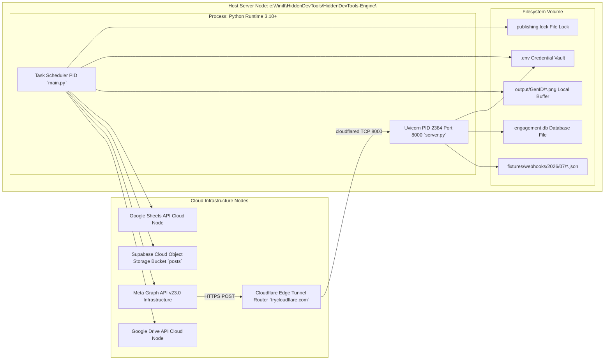

# Canonical Deployment Topology & Class Diagrams (`Deployment_Diagram.md` & `Class_Diagram.md`)

**Document ID:** HDT-DIAG-007  
**Category:** Diagram Specifications  
**Version:** 1.0  
**Status:** Canonical Engineering Baseline  
**Cross-References:** [Deployment Runbook](file:///e:/Vinitt/HiddenDevTools/HiddenDevTools-Engine/docs/12_Deployment/Deployment.md), [Backend Reference](file:///e:/Vinitt/HiddenDevTools/HiddenDevTools-Engine/docs/03_Backend/Backend.md)

---

## Part 1: Standalone Deployment Topology (`Deployment_Diagram.md`)

---

## Part 2: Canonical Class & Interface Diagram (`Class_Diagram.md`)

```mermaid
classDiagram
    class BaseRenderer {
        <<abstract>>
        +render_carousel(row: Dict, post_name: str)* str
    }
    class DeveloperToolsRenderer {
        +render_carousel(row: Dict, post_name: str) str
        -_draw_cover(draw, row, coords)
        -_draw_content(draw, row, coords)
    }
    class Engine {
        +image: Image
        +draw: ImageDraw
        +font_cache: Dict
        +__init__(template_path: str)
        +get_font(font_name: str, size: int) ImageFont
        +paragraph(text: str, x: int, y: int, max_w: int, max_h: int, size: int, min_size: int)
    }
    BaseRenderer <|-- DeveloperToolsRenderer
    DeveloperToolsRenderer --> Engine : instantiates & uses

    class SheetService {
        +get_draft_rows(limit: int) List[Dict]
        +lock_row_for_rendering(row: Dict) bool
        +mark_row_published(row: Dict, post_name: str, media_id: str, url: str) bool
    }
    class SupabaseStorage {
        +supabase_url: str
        +service_key: str
        +bucket: str
        +upload_post_images(local_folder: str, gen_id: str) List[str]
        +_upload_concurrently(tasks: List[Tuple])
        +_upload_single(local_path: str, remote_path: str) str
        +verify_url(url: str) bool
    }
    class InstagramService {
        +access_token: str
        +account_id: str
        +page_id: str
        +api_version: str
        +_make_request(method, endpoint, params, json_data, max_retries, timeout) Dict
        +send_message(recipient_id: str, text: str) MessageResult
        +create_media_container(image_url: str) Dict
        +wait_for_container(container_id: str, max_wait: int) bool
        +create_carousel(container_ids: List[str], caption: str) Dict
        +publish(creation_id: str) Dict
        +publish_carousel(image_urls: List[str], caption: str) Dict
    }

    class WebhookEvent {
        +comment_id: str
        +media_id: str
        +user_id: str
        +username: str
        +text: str
        +timestamp: datetime
    }
    class ProcessedComment {
        +comment_id: str
        +media_id: str
        +user_id: str
        +username: str
        +original_text: str
        +normalized_text: str
        +status: DMStatus
        +attempt_count: int
        +next_retry_at: datetime
    }
    class DeduplicationRepository {
        +db_path: str
        +__init__(db_path: str)
        +has_processed_comment(comment_id: str) bool
        +has_user_received_dm(user_id: str, media_id: str) bool
        +save_processed_comment(comment: ProcessedComment)
        +claim_pending_comments(limit: int) List[ProcessedComment]
        +mark_sent(comment_id: str)
        +mark_failed(comment_id: str, reason: str)
        +mark_retry(comment_id: str, reason: str, attempt_count: int, next_retry_at: datetime)
    }
    class CommentProcessor {
        +repository: DeduplicationRepository
        +matcher: KeywordMatcher
        +dispatcher: QueueDispatcher
        +process_event(event: WebhookEvent)
    }
    class DMWorker {
        +repository: DeduplicationRepository
        +instagram_service: InstagramService
        +template_renderer: TemplateRenderer
        +process_queue()
    }

    CommentProcessor --> DeduplicationRepository : queries & inserts
    DMWorker --> DeduplicationRepository : claims & transitions
    DMWorker --> InstagramService : calls send_message
```

