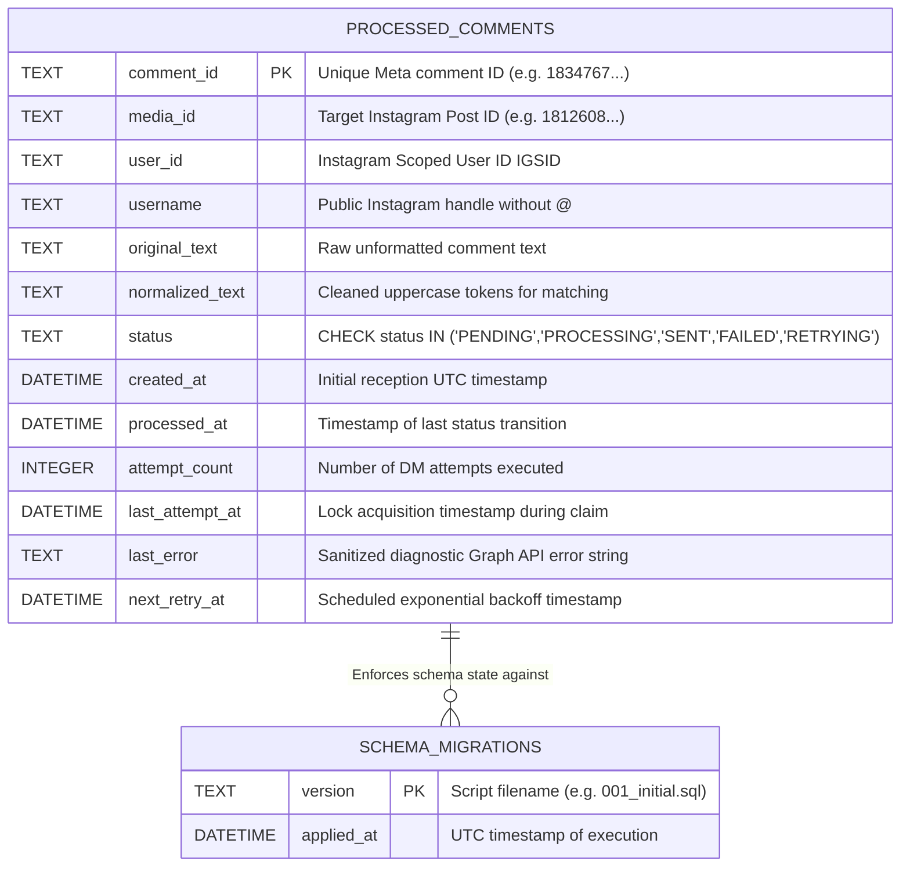

# Canonical Entity-Relationship & Component Visual Diagrams (`ER_Diagram.md` & `Component_Diagram.md`)

**Document ID:** HDT-DIAG-005  
**Category:** Diagram Specifications  
**Version:** 1.0  
**Status:** Canonical Engineering Baseline  
**Cross-References:** [Database Specifications](file:///e:/Vinitt/HiddenDevTools/HiddenDevTools-Engine/docs/08_Database/Database.md), [Complete System Architecture](file:///e:/Vinitt/HiddenDevTools/HiddenDevTools-Engine/docs/14_Diagrams/Complete_System_Architecture.md)

---

## Part 1: Entity-Relationship Diagram (`ER_Diagram.md`)



---

## Part 2: Component Architecture Diagram (`Component_Diagram.md`)

```mermaid
graph TB
    subgraph Client Application Layer
        IGApp[Instagram Mobile App / User Account]
        CronCLI[Task Scheduler / python main.py]
    end

    subgraph HTTP Controller & Routing Component (`routers/`)
        Server[server.py Uvicorn Application Factory]
        HealthController[routers/health.py GET /health]
        WebhookController[routers/meta_webhook.py GET/POST /webhooks/meta]
        Server --> HealthController
        Server --> WebhookController
    end

    subgraph Service Adapter Component (`services/`)
        WebhookSvc[services/meta_webhook_service.py]
        SheetSvc[services/sheet_service.py]
        StorageSvc[services/storage_service.py]
        IGSvc[services/instagram_service.py]
        DriveSvc[services/drive_service.py]
        CaptionSvc[services/caption_service.py]
        GenSvc[services/generation_service.py]
    end

    subgraph Domain Feature Component (`features/engagement/`)
        CommentProc[comment_processor.py]
        KeywordMatch[keyword_matcher.py]
        Dispatcher[dispatcher.py / QueueDispatcher]
        Repo[repository.py / DeduplicationRepository]
        Worker[worker.py / DMWorker]
        TemplateRend[template_renderer.py]
        MigRunner[migrations_runner.py]
    end

    subgraph Rendering Component (`engine.py` & `renderers/`)
        EngineCore[engine.py / Engine]
        DevToolsRend[renderers/developer_tools_renderer.py]
        DevToolsRend --> EngineCore
    end

    CronCLI --> SheetSvc
    CronCLI --> DevToolsRend
    CronCLI --> StorageSvc
    CronCLI --> IGSvc
    CronCLI --> DriveSvc
    WebhookController --> WebhookSvc
    WebhookSvc --> CommentProc
    CommentProc --> KeywordMatch
    CommentProc --> Repo
    CommentProc --> Dispatcher
    Dispatcher --> Worker
    Worker --> Repo
    Worker --> TemplateRend
    Worker --> IGSvc
    Repo --> MigRunner
```
