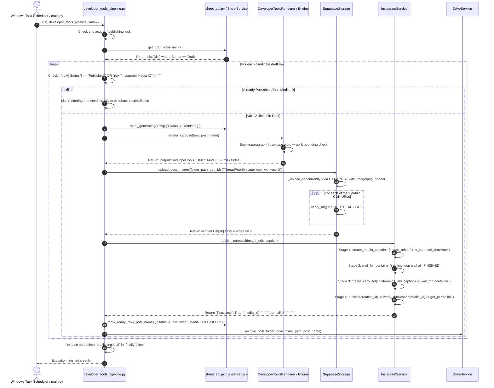
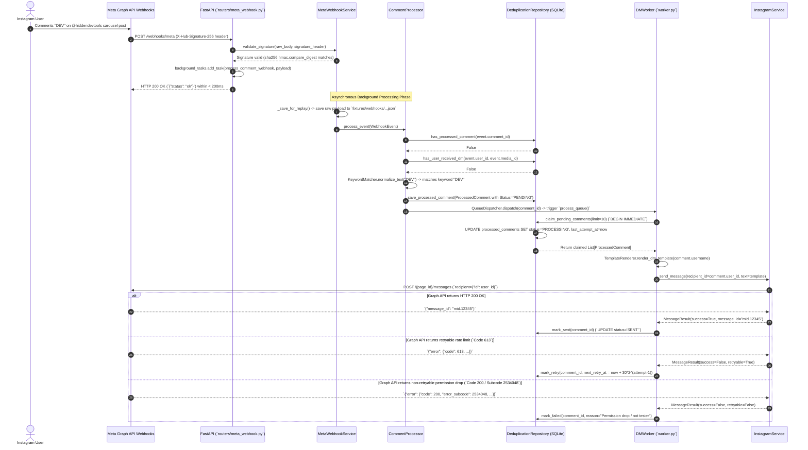

# Canonical Publishing Sequence Diagram (`Publishing_Sequence_Diagram.md` & `Webhook_Sequence_Diagram.md`)

**Document ID:** HDT-DIAG-003  
**Category:** Diagram Specifications  
**Version:** 1.0  
**Status:** Canonical Engineering Baseline  
**Cross-References:** [Data Flow Diagram](file:///e:/Vinitt/HiddenDevTools/HiddenDevTools-Engine/docs/14_Diagrams/Data_Flow_Diagram.md), [Complete System Architecture](file:///e:/Vinitt/HiddenDevTools/HiddenDevTools-Engine/docs/14_Diagrams/Complete_System_Architecture.md)

---

## Part 1: Publishing Pipeline Sequence (`Publishing_Sequence_Diagram.md`)

---

## Part 2: Webhook Reception & Messaging Sequence (`Webhook_Sequence_Diagram.md`)

