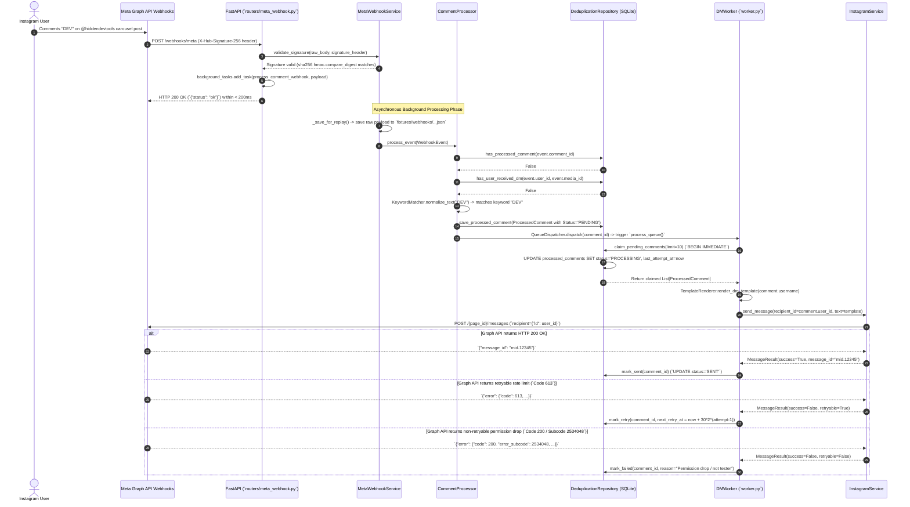

# Canonical Webhook Reception & Direct Messaging Sequence (`Webhook_Sequence_Diagram.md`)

**Document ID:** HDT-DIAG-004  
**Category:** Diagram Specifications  
**Version:** 1.0  
**Status:** Canonical Engineering Baseline  
**Cross-References:** [Publishing Sequence Diagram](file:///e:/Vinitt/HiddenDevTools/HiddenDevTools-Engine/docs/14_Diagrams/Publishing_Sequence_Diagram.md), [Engagement Specifications](file:///e:/Vinitt/HiddenDevTools/HiddenDevTools-Engine/docs/07_Engagement/Engagement.md)

---

## 1. Webhook to Direct Message Chronological Flow

