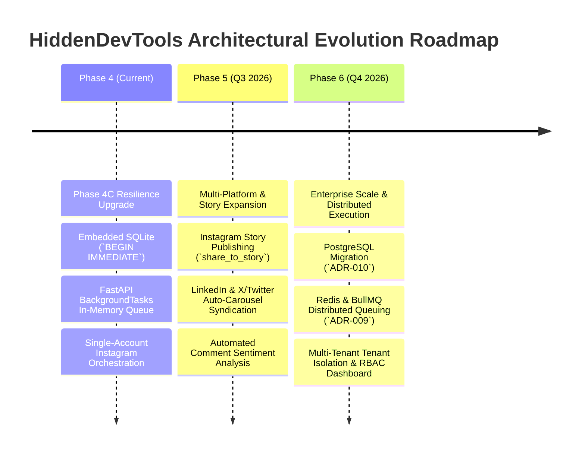

# Strategic Technical Roadmap & Technical Debt Registry (`Future_Roadmap.md` & `Technical_Debt.md`)

**Document ID:** HDT-FUT-001  
**Category:** Future & Evolution Specifications  
**Version:** 1.0  
**Status:** Canonical Engineering Baseline  
**Cross-References:** [Migration to PostgreSQL](file:///e:/Vinitt/HiddenDevTools/HiddenDevTools-Engine/docs/15_Future/Migration_to_PostgreSQL.md), [Migration to BullMQ](file:///e:/Vinitt/HiddenDevTools/HiddenDevTools-Engine/docs/15_Future/Migration_to_BullMQ.md), [ADR-009](file:///e:/Vinitt/HiddenDevTools/HiddenDevTools-Engine/docs/02_Architecture/ADR-009_Queue_Design.md), [ADR-010](file:///e:/Vinitt/HiddenDevTools/HiddenDevTools-Engine/docs/02_Architecture/ADR-010_Migration_Strategy.md)

---

## Part 1: Strategic Technical Roadmap (`Future_Roadmap.md`)

As `HiddenDevTools` scales from `@hiddendevtools` (`10k followers`) toward a multi-brand social publishing network (`100k+ followers`), the engineering architecture must transition from a single-station SQLite scheduler into a distributed, multi-tenant microservices ecosystem.

### Phase 5 Detailed Deliverables (Q3 2026)
1. **Automated Story Syndication (`share_to_story`):** Extend `InstagramService` to automatically create vertical `1080x1920` summary teaser cards (`00_Story_Teaser.png`) and publish them to Instagram Stories with a sticker link directing users to the newly dropped grid post (`GET /{media_id}/insights`).
2. **Multi-Platform Cross-Posting:** Build a modular `BasePublisher` abstract class allowing concurrent publication of rendered carousels to **LinkedIn Company Pages** (PDF Document Carousels) and **X/Twitter Threads**.
3. **Sentiment & Engagement Analytics:** Integrate a lightweight NLP classifier (`VADER` / `OpenAI gpt-4o-mini`) inside `CommentProcessor` to tag incoming comments by sentiment (`Enthusiastic`, `Question`, `Bug Report`) and pipe high-priority product questions directly to the engineering team's Slack channel (`POST /services/T000/B000/xxxx`).

---

## Part 2: Technical Debt Registry (`Technical_Debt.md`)

The table below catalogs known technical debt across the codebase, its impact on reliability or scale, and the required engineering refactor.

| Debt ID | Subsystem | Debt Description & Current Implementation | Severity | Target Resolution Phase | Concrete Refactor Strategy |
| :--- | :--- | :--- | :--- | :--- | :--- |
| **DEBT-01** | **Task Queuing (`server.py`)** | **In-Memory `BackgroundTasks` Vulnerability:** `routers/meta_webhook.py` pushes comment jobs onto Uvicorn's RAM event loop via `background_tasks.add_task()`. If the server crashes or reboots mid-processing, queued jobs in memory are lost prior to SQLite persistence (`save_processed_comment`). | **Medium** | Phase 6 | Transition webhook reception to write `PENDING` records to PostgreSQL immediately within the synchronous webhook request, or offload processing to a dedicated Redis cluster via `BullMQ` / `Celery` (`ADR-009`). |
| **DEBT-02** | **Database Concurrency (`engagement.db`)** | **Single-File Write Bottleneck:** SQLite `BEGIN IMMEDIATE` locks the entire database file during state transitions (`claim_pending_comments`). While optimal for `< 50 req/sec`, concurrent traffic bursts exceeding `200 req/sec` will experience lock contention and query latency. | **Medium** | Phase 6 | Migrate transactional state from embedded SQLite to managed **PostgreSQL 16+** (`ADR-010`), utilizing row-level `SELECT ... FOR UPDATE SKIP LOCKED` semantics. |
| **DEBT-03** | **Canvas Rendering (`engine.py`)** | **Synchronous CPU-Bound Pillow Synthesis:** Synthesizing 9 high-res PNG slides executes synchronously inside `asyncio.to_thread()`. Under high concurrency, heavy Pillow operations can starve Python thread pools. | **Low** | Phase 5 | Offload `DeveloperToolsRenderer` to an isolated microservice (`Render Worker Cluster`) running compiled Go or Rust (`canvas` / `skia-python`) or serverless AWS Lambda / Cloudflare Workers (`NFR-01`). |
| **DEBT-04** | **Configuration Governance (`config.py`)** | **Flat `.env` Singleton Dictionary:** `config.py` loads variables globally via `load_dotenv(override=True)`. While simple, it lacks schema validation or type-checked defaults at application boot. | **Low** | Phase 5 | Replace raw `os.getenv()` lookups with `pydantic-settings` (`BaseSettings`), enforcing strict boot-time validation of required secrets (`META_APP_SECRET`, `INSTAGRAM_ACCESS_TOKEN`). |
