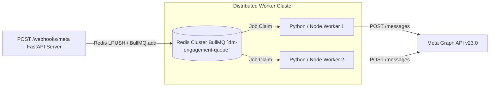

# Enterprise Transition Runbook: Migration to BullMQ & Redis (`Migration_to_BullMQ.md`)

**Document ID:** HDT-FUT-004  
**Category:** Future & Evolution Specifications  
**Version:** 1.0  
**Status:** Canonical Engineering Baseline  
**Cross-References:** [ADR-009](file:///e:/Vinitt/HiddenDevTools/HiddenDevTools-Engine/docs/02_Architecture/ADR-009_Queue_Design.md), [Engagement Specifications](file:///e:/Vinitt/HiddenDevTools/HiddenDevTools-Engine/docs/07_Engagement/Engagement.md), [Future Roadmap](file:///e:/Vinitt/HiddenDevTools/HiddenDevTools-Engine/docs/15_Future/Future_Roadmap.md)

---

## 1. Architectural Justification (`ADR-009`)

While `FastAPI.BackgroundTasks` combined with SQLite `BEGIN IMMEDIATE` (`Phase 4C`) effectively manages single-server webhook queues up to `50 comments/sec`, memory-backed background threads cannot survive application restarts or scale across multi-host Kubernetes worker nodes (`DEBT-01`).

Migrating the background dispatching layer to **Redis 7+** and **BullMQ** (`Phase 6`) introduces external job durability, centralized rate-limiting (`max 50 DMs per minute`), distributed delayed retries (`backoff.type = 'exponential'`), and dead-letter queue (DLQ) visibility.



---

## 2. Queue Configuration & Dispatcher Refactor

### 2.1 Queue Job Payload Specification (`CommentJobPayload`)
When `routers/meta_webhook.py` receives a validated webhook, it serializes the `WebhookEvent` into Redis instead of memory:
```json
{
  "jobId": "comment:18347679586170300",
  "commentId": "18347679586170300",
  "mediaId": "18126080746733956",
  "userId": "3705030049648518",
  "username": "imvinitbruhhhh",
  "text": "DEV",
  "attempt": 1
}
```
* **Deduplication Key (`jobId`):** Setting `jobId = f"comment:{event.comment_id}"` ensures BullMQ automatically drops duplicate webhook delivery retries directly at the Redis boundary (`O(1)` hash lookup) prior to hitting PostgreSQL.

### 2.2 BullMQ Producer & Worker Options Specification
To mirror exact rate limits (`Code 613`) and exponential backoff behavior inside BullMQ:
```javascript
// TypeScript / Python BullMQ Configuration
const dmQueue = new Queue('dm-engagement-queue', {
  connection: { host: 'redis-cluster.internal', port: 6379 },
  defaultJobOptions: {
    attempts: 3,
    backoff: {
      type: 'exponential',
      delay: 30000 // Base delay: 30s -> 60s -> 120s
    },
    removeOnComplete: { age: 86400, count: 1000 }, // Keep 24 hrs for auditing
    removeOnFail: { age: 604800 }                  // Keep 7 days in DLQ
  }
});

// Enforce strict rate limiter: Max 50 Graph API calls per 60 seconds
const dmWorker = new Worker('dm-engagement-queue', async job => {
  await processDirectMessage(job.data);
}, {
  limiter: {
    max: 50,
    duration: 60000
  }
});
```
